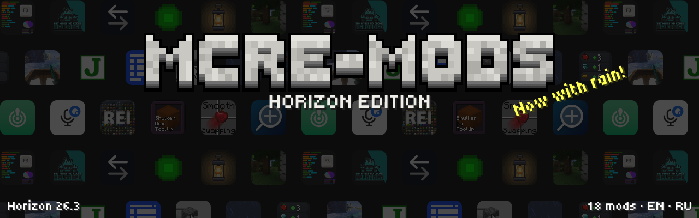

 

 
 
&nbsp;

The best Java Edition mods, ported by hand to <a href="https://github.com/horizon-rust/horizon">Horizon</a> — the Rust rewrite of Minecraft: Java Edition 26.3. Every mod works like the original: the same features, settings and look.

## Mods

### 🌧️ Atmosphere

### 🎤 Play together

### 🎒 Inventory

### 📖 Recipes and info

### ✨ Less lag, less noise

## What's next

## How to install

1. Open the **Horizon launcher** and go to **Mods**.
2. Find a mod, press **Install**, then **Native build > Build**.
3. Start the game: the mod is in **Options > Mods** and in Mod Menu.

Native mods are compiled into the game and are not sandboxed: build only code you trust. Every mod here is open source.

## Found a bug?

[Report it here](https://github.com/DeportedToHell/MCRE-Mods/issues/new/choose): pick the mod, say what happened, add a screenshot if you can. English or Russian.

## Credits

Every mod keeps its original's licence and credits its authors: see the README, LICENSE and NOTICE in its folder. Ported by **DeportedToHell** and **Kastromovskiy**.
Not an official Minecraft product. Not approved by or associated with Mojang or Microsoft.
