
 

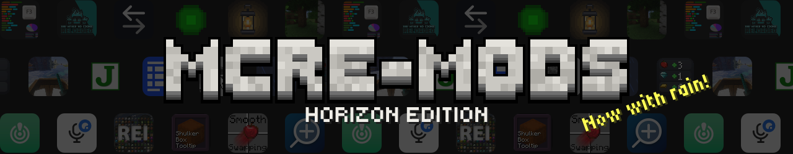 <a href="#mods">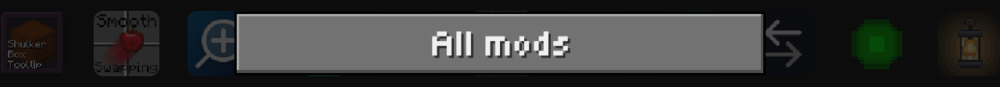</a> <a href="https://github.com/DeportedToHell/MCRE-Mods/issues/new/choose">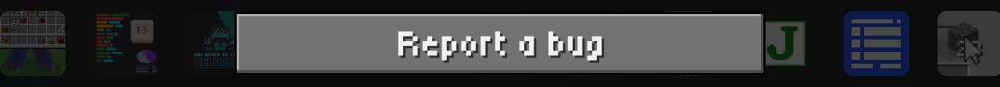</a> <a href="https://playhorizon.dev/mods">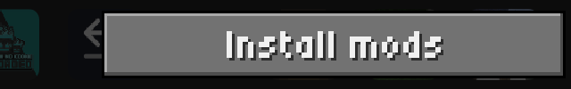</a>  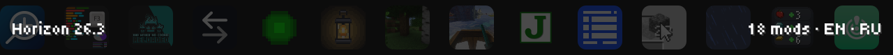

<b>Ports of the best Java Edition mods — and our own versions of them with new features — made for <a href="https://github.com/horizon-rust/horizon">Horizon</a>, Minecraft: Java Edition 26.3 rewritten in Rust.</b> Faithful ports look and play just like the originals: the same features, settings and screens. Native, fast and open source.

## Mods

### 🌧️ Atmosphere

<a href="particlerain"><picture><source media="(max-width: 700px)" srcset=".github/readme/card-particlerain-en-phone.svg">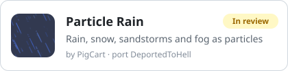</picture></a>
<a href="fallingleaves"><picture><source media="(max-width: 700px)" srcset=".github/readme/card-fallingleaves-en-phone.svg">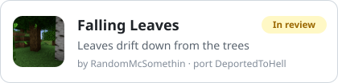</picture></a>
<a href="betterdynamiclights"><picture><source media="(max-width: 700px)" srcset=".github/readme/card-dynamiclights-en-phone.svg">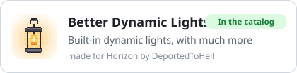</picture></a>
<a href="firstpersonmodel"><picture><source media="(max-width: 700px)" srcset=".github/readme/card-firstpersonmodel-en-phone.svg">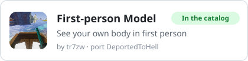</picture></a>

### 🎤 Play together

<a href="emotecraft"><picture><source media="(max-width: 700px)" srcset=".github/readme/card-emotecraft-en-phone.svg">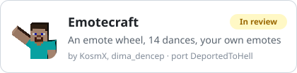</picture></a>
<a href="plasmovoice"><picture><source media="(max-width: 700px)" srcset=".github/readme/card-plasmovoice-en-phone.svg">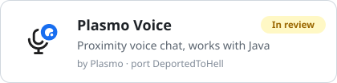</picture></a>
<a href="pingwheel"><picture><source media="(max-width: 700px)" srcset=".github/readme/card-pingwheel-en-phone.svg"></picture></a>

### 🎒 Inventory

<a href="clientsort"><picture><source media="(max-width: 700px)" srcset=".github/readme/card-clientsort-en-phone.svg">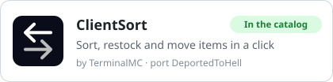</picture></a>
<a href="mousetweaks"><picture><source media="(max-width: 700px)" srcset=".github/readme/card-mousetweaks-en-phone.svg">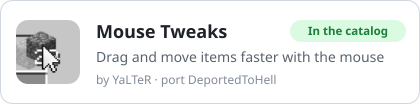</picture></a>
<a href="smoothswapping"><picture><source media="(max-width: 700px)" srcset=".github/readme/card-smoothswapping-en-phone.svg">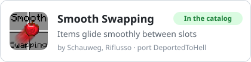</picture></a>
<a href="shulkerboxtooltip"><picture><source media="(max-width: 700px)" srcset=".github/readme/card-shulkerboxtooltip-en-phone.svg">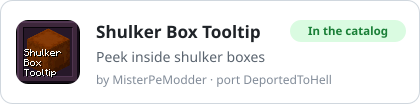</picture></a>
<a href="pickupnotifier"><picture><source media="(max-width: 700px)" srcset=".github/readme/card-pickupnotifier-en-phone.svg">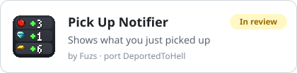</picture></a>
<a href="invmove"><picture><source media="(max-width: 700px)" srcset=".github/readme/card-invmove-en-phone.svg">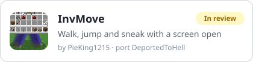</picture></a>
<a href="travelersbackpack"><picture><source media="(max-width: 700px)" srcset=".github/readme/card-travelersbackpack-en-phone.svg">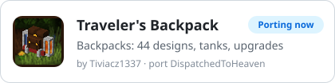</picture></a>

### 📖 Recipes and info

<a href="justenoughitems"><picture><source media="(max-width: 700px)" srcset=".github/readme/card-justenoughitems-en-phone.svg">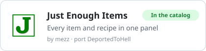</picture></a>
<a href="roughlyenoughitems"><picture><source media="(max-width: 700px)" srcset=".github/readme/card-roughlyenoughitems-en-phone.svg">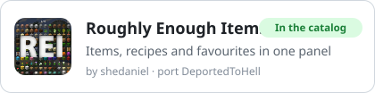</picture></a>
<a href="modmenu"><picture><source media="(max-width: 700px)" srcset=".github/readme/card-modmenu-en-phone.svg">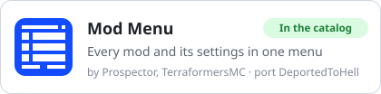</picture></a>
<a href="betterf3"><picture><source media="(max-width: 700px)" srcset=".github/readme/card-betterf3-en-phone.svg">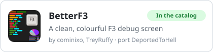</picture></a>
<a href="zoomify"><picture><source media="(max-width: 700px)" srcset=".github/readme/card-zoomify-en-phone.svg">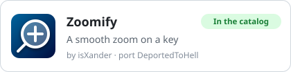</picture></a>

### ✨ Less lag, less noise

<a href="clumps"><picture><source media="(max-width: 700px)" srcset=".github/readme/card-clumps-en-phone.svg">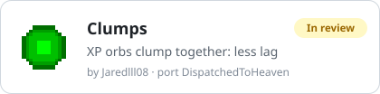</picture></a>
<a href="bwncr"><picture><source media="(max-width: 700px)" srcset=".github/readme/card-bwncr-en-phone.svg">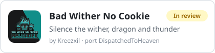</picture></a>

## What's next

<picture><source media="(max-width: 700px)" srcset=".github/readme/roadmap-en-phone.svg"></picture>

## How to install

1. Open the **Horizon launcher** and go to **Mods**.
2. Find a mod, press **Install**, then **Native build > Build**.
3. Start the game: the mod is in **Options > Mods** and in Mod Menu.

Native mods are compiled into the game and are not sandboxed: build only code you trust. Every mod here is open source.

## Found a bug?

[Report it here](https://github.com/DeportedToHell/MCRE-Mods/issues/new/choose): pick the mod, say what happened, add a screenshot if you can. English or Russian.

## Credits

Every mod keeps its original's licence and credits its authors: see the README, LICENSE and NOTICE in its folder. Ported by **DeportedToHell** and **DispatchedToHeaven**.
Not an official Minecraft product. Not approved by or associated with Mojang or Microsoft.
