
 

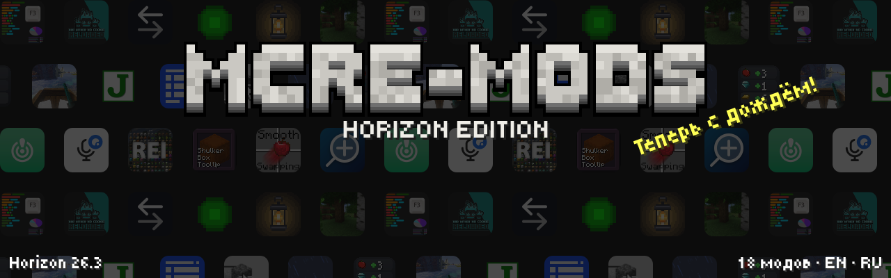

 
 
<a href="https://playhorizon.dev/mods">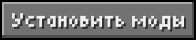</a>&nbsp;

Лучшие моды Java Edition, вручную перенесённые на <a href="https://github.com/horizon-rust/horizon">Horizon</a> — Minecraft: Java Edition 26.3, переписанный на Rust. Каждый мод работает как оригинал: те же функции, настройки и внешний вид.

## Моды

### 🌧️ Атмосфера

<a href="particlerain">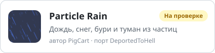</a>
<a href="fallingleaves">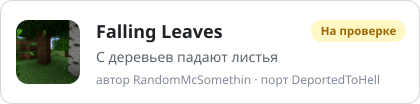</a>
<a href="dynamiclights">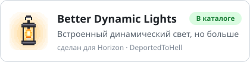</a>
<a href="firstpersonmodel">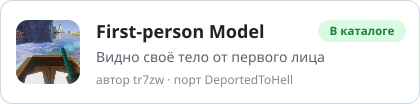</a>

### 🎤 Играть вместе

<a href="plasmovoice">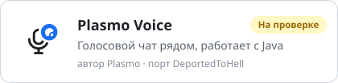</a>
<a href="pingwheel">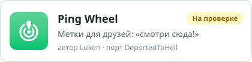</a>

### 🎒 Инвентарь

<a href="clientsort">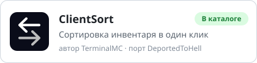</a>
<a href="mousetweaks">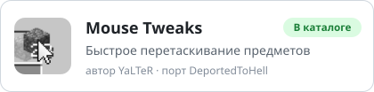</a>
<a href="smoothswapping">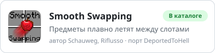</a>
<a href="shulkerboxtooltip">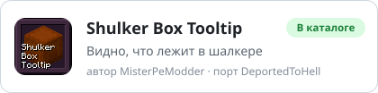</a>
<a href="pickupnotifier">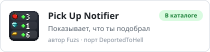</a>

### 📖 Рецепты и интерфейс

<a href="justenoughitems">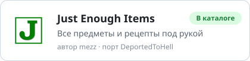</a>
<a href="roughlyenoughitems">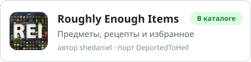</a>
<a href="modmenu">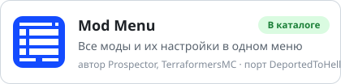</a>
<a href="betterf3">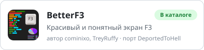</a>
<a href="zoomify">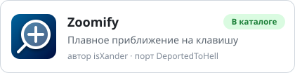</a>

### ✨ Меньше лагов и шума

<a href="clumps">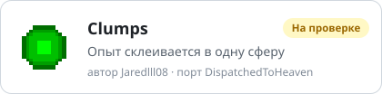</a>
<a href="bwncr">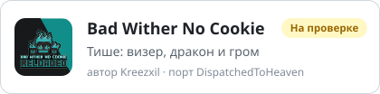</a>

## Что дальше

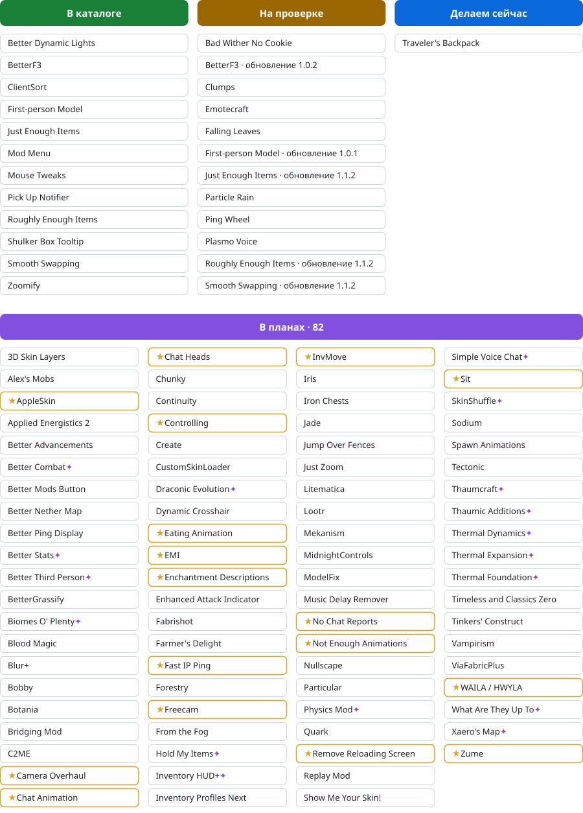

## Как установить

1. Открой **лаунчер Horizon** и зайди во вкладку **Моды**.
2. Найди мод, нажми **Установить**, потом **Native build > Build**.
3. Запусти игру: мод появится в **Настройки > Моды** и в Mod Menu.

Нативные моды собираются прямо в игру и не изолированы: ставь только то, чему доверяешь. Все моды здесь с открытым кодом.

## Нашли ошибку?

[Напишите о ней здесь](https://github.com/DeportedToHell/MCRE-Mods/issues/new/choose): выберите мод, расскажите, что случилось, по возможности приложите скриншот. Можно по-русски.

## Авторы

Каждый мод сохраняет лицензию оригинала и указывает его авторов: README, LICENSE и NOTICE в папке мода. Порты делают **DeportedToHell** и **Kastromovskiy**.
Не официальный продукт Minecraft. Не одобрен Mojang или Microsoft и не связан с ними.
