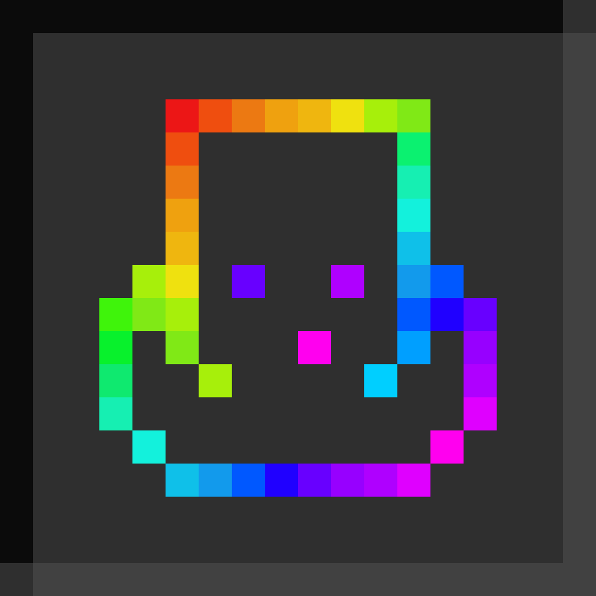
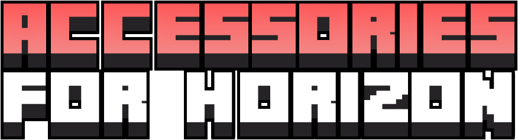
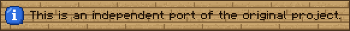
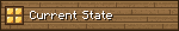
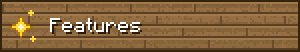
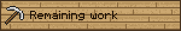
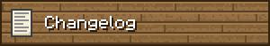
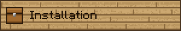
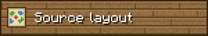
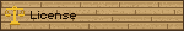

   


## 


> It is not affiliated with, endorsed by, or officially associated with the original authors, Wisp Forest.
>
> Original mod: https://github.com/wisp-forest/accessories
>
> Special thanks to [blodhgarm](https://github.com/Dragon-Seeker), [chyzman](https://github.com/chyzman), Dr.Zeal and all contributors for creating the original mod.


## 


0.2.1. Unplayable.

BOTH FILES ARE REQUIRED FOR THE MOD TO WORK

`accessories.hmod`

`accessories_native.hnmod`

I'll release an updated mod to the launcher as soon as Horizon rolls out an update that merges `.hnmod` into `.hmod`.


## 


**Accessory slots.** Hat, face, necklace, cape, back, hands, rings, wrist, belt, anklet, shoes and charm. Data packs can add slots or change them, same format as the original.

**Accessories screen.** Press **H** or the button in the inventory. Cosmetic slots, a show/hide toggle on every slot, and a settings panel for the layout and a dark theme.

**Equipping.** Drag, shift-click or right-click an accessory. Curses of binding and vanishing work, and keepInventory keeps accessories.

**For other mods.** Items can give attributes, effects and extra slots while worn, and a totem works from an accessory slot. Accessories are drawn on the player, and other players see them.

**Other features.** `/accessories` commands, the original's config file (`config/accessories.json5`), Mod Menu info. Works with [Traveler's Backpack](../travelersbackpack): the backpack goes in the Back slot. English and Russian.


## 


Not implemented compared to the original:

- **Needs Horizon hooks.** Cosmetic armor drawn instead of the worn one, elytra gliding from an accessory slot, the `keepAccessoryInventory` game rule, piglin, freezing and enderman protection, enchantments of worn accessories, accessories on the screen's player view.
- **Not done yet.** The crafting grid on the screen, equip reasons in slot tooltips, the config screen in Mod Menu, dispensers, accessories on armor stands and horses, advancement criteria and data-driven renderers.

Differences: the screen's player view always faces the cursor, so the second view isn't turned around.


## 


### 0.2.1

- [Traveler's Backpack](../travelersbackpack) goes in the Back slot.
- Items can have their own renderer and turn off right-click equipping.
- Fixed items getting lost when a worn backpack changed while the screen was open.

### 0.2.0

- Item components: valid slots, attributes, stack size, nested accessories and mob effects.
- Slot sizes change with worn items and `/accessories slot modifier`.
- Item tooltips, the config file, the screen settings panel, pages, dark theme.
- `/accessories` commands and totems in accessory slots.

### 0.1.0

- First release: slots from data, the accessories screen, equipping, drops on death, accessories on the player.


## 


Build the content mod with `cargo horizon-mod build` from `content/` and place the resulting `.hmod` in the game's mods folder.

Package the native mod using `tools/package.mjs` and place the resulting `.hnmod` in `<game folder>/horizon-native-mods/`. Add `mod.accessories_native:true` to `horizon-mods.txt`, then select **Native build → Build** in the launcher.

> Native mods are compiled into the game and are not sandboxed. Only build code you trust.


## 


```text
content/                         Content mod, generated from the original checkout
horizon-native.json              Native bundle manifest
mixins/accessories_native/
  horizon-mixin.toml             Modules and injections
  glue.rs                        Main mod implementation
  menu.rs                        The accessories menu, slot rules and item components
  screen_relayout.rs             The screen's layout
  h_*.rs                         Injection helpers
  data/icon.png                  Original Accessories icon
tools/
  content.mjs                    Generates content/ from the original checkout
  check.sh                       Stages the mod on pinned Horizon source and checks/builds the game
  package.mjs                    Packages the .hnmod
```


## 


Licensed under **MIT**, same as the original project.

**Original authors:** [blodhgarm](https://github.com/Dragon-Seeker), [chyzman](https://github.com/chyzman), Dr.Zeal ([Wisp Forest](https://github.com/wisp-forest))  
**Port author:** [DispatchedToHeaven](https://github.com/DispatchedToHeaven)

See `LICENSE` and `NOTICE` for details.

This project is an independent port and is not affiliated with or endorsed by Wisp Forest, Mojang, or Microsoft.
