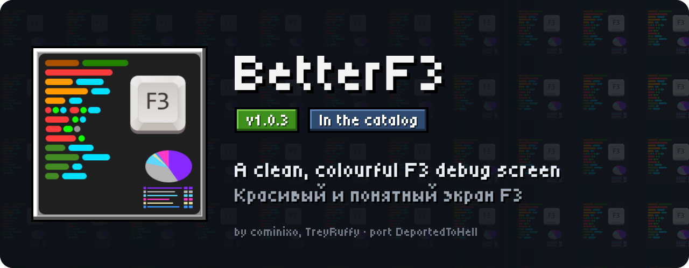
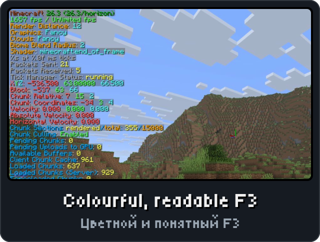
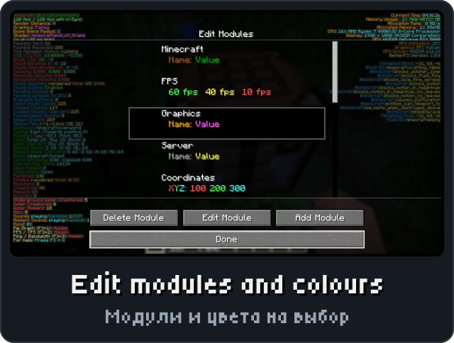
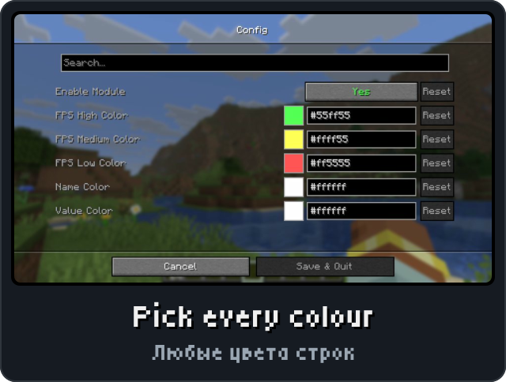
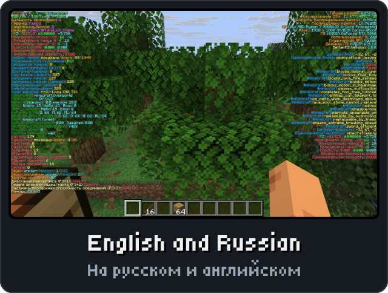

<p align="center"><picture><source media="(max-width: 700px)" srcset="../.github/releases/betterf3/hero-phone.svg"></picture></p>

<p align="center"><a href="https://github.com/DeportedToHell/MCRE-Mods/releases/download/betterf3-1.0.2/betterf3-1.0.2.hnmod"><picture><source media="(max-width: 700px)" srcset="../.github/releases/betterf3/download-phone.svg"></picture></a><br>
<a href="https://playhorizon.dev/mods/betterf3"><picture><source media="(max-width: 700px)" srcset="../.github/releases/betterf3/catalog-phone.svg"></picture></a><br>
<a href="https://github.com/DeportedToHell/MCRE-Mods/releases/tag/betterf3-1.0.2"><picture><source media="(max-width: 700px)" srcset="../.github/releases/betterf3/github-phone.svg"></picture></a></p>

<p align="center"></p>

<p align="center">




</p>

<p align="center"></p>

<p align="center"><picture><source media="(max-width: 700px)" srcset="../.github/releases/common/steps-phone.svg"> Build" width="640"></picture></p>

<details>
<summary><b>All features in detail · Все возможности подробно</b></summary>

A port of [BetterF3](https://github.com/TreyRuffy/BetterF3) by cominixo and TreyRuffy to
[Horizon](https://github.com/horizon-rust/horizon), the Rust rewrite of Minecraft: Java Edition 26.3, as a
native mod (`.hnmod`). It replaces the debug screen (F3) with BetterF3's customizable, colour-coded,
human-readable one, as the Java mod does.

### Features

- **Modules** in two columns, each in its own colours: Minecraft, FPS, Graphics, Server, Coordinates,
  Chunks, Location, Entities, Sounds, Help and Misc on the left; System, Misc and Targeted (block, fluid,
  entity) on the right; Separators between them.
- **Extra lines** BetterF3 adds: velocity, absolute and horizontal velocity, slime chunk, current day ticks
  and days played, region file, each heightmap, which charts are shown, the current time (in your own
  format), memory coloured by how full it is, FPS coloured high/medium/low.
- **Line backgrounds**, text shadow, font scale, a space after each module, and the **sliding animation**
  when F3 opens and closes (with its speed).
- While F3 is open the **boss bar** and the **sidebar** are hidden (options); the game's charts (F3+2,
  F3+3, F3+4) still show over it.
- **Auto Start** opens F3 when you join a world, and can turn the TPS or ping chart on with it.
- **Keys** as in BetterF3: **F3+M** opens the config, **F3+F** cycles the render distance (**Shift** to
  go down), **Ctrl+F3+F** the simulation distance; the new value goes to the chat.
- **BetterF3's config screens**, in English or Russian with the game's language:
  - *Config*: General Settings, Left Modules, Right Modules, Done.
  - *Edit Modules*: the column's modules with a sample of their colours; the arrows on a module's icon
    move it up or down; Edit Module, Add Module (any module, Separator included), Delete Module. F3 shows
    behind it in a world.
  - *Edit Module* (Cloth Config): enable the module, its colours (name, value, X/Y/Z, FPS levels,
    enabled/disabled/total, maximum, background), the separator's line count, the memory colours and time
    format, and every line on or off.
  - *General Settings* (Cloth Config): Disable Mod, Auto Start, Space Modules, Performance Optimizations,
    Shadow Text, Enable Animations, Animation Speed, Font Scale, Background Color (ARGB), Hide the Debug
    Crosshair, Hide Sidebar, Hide Bossbar, Always Enable the Profiler / TPS Graph / Ping Graph.

  They open from **Options > Mods > BetterF3 > Configure...**, from Mod Menu's Configure button and with
  F3+M in a world. Settings are kept in BetterF3's own format (`betterf3.json`, as Java's
  `config/betterf3.json`) in `horizon-mods/.horizon-mod-data/betterf3/`.

#### Differences from the Java mod

Horizon is not the Java game, so a few lines show Horizon's own numbers or nothing:

- No *Java Version* line (Horizon has no JVM); memory is the game process's (used and resident memory of
  the machine's), as Horizon's own F3 shows it.
- *Pie Graph* is always "Hidden": Horizon has no profiler chart yet.
- *Available Buffers* is 0 and *Chunk Culling* always "Enabled" (Horizon keeps no buffer pool and always
  culls); *Light (Server)* shows the same light as *Light*.
- *Local Difficulty*, *Loaded Chunks (Server)*, *Spawn Chunks*, the mob categories and the server's
  heightmaps come from the integrated server, so in multiplayer they stay empty as in Java without a
  server level.
- Numbers use a dot as the decimal separator whatever the system's language (Java follows the system
  locale).

</details>

<details>
<summary><b>Install by hand and source code · Установка вручную и исходный код</b></summary>

### Install

From the launcher: Mods, find **BetterF3**, Install, then Native build > Build.

By hand: put `betterf3-<version>.hnmod` in `<game folder>/horizon-native-mods/`, add the line
`mod.betterf3:true` to `horizon-mods.txt`, then Native build > Build in the launcher.

Native mods are compiled into the game and are not sandboxed: build only code you trust.

### Source layout

```
horizon-native.json            bundle manifest (id, version, pinned Horizon and horizon-mixins revisions)
mixins/betterf3/
  horizon-mixin.toml           modules and injections
  runtime.rs                   settings, modules and their lines, betterf3.json, texts
  lines.rs                     each module's update: the game's data
  overlay.rs                   the debug screen, its animation, the hidden boss bar and sidebar
  screens.rs                   ModConfigScreen, ModulesScreen, the Cloth Config screens, F3+M and F3+F
  cloth.rs, cloth_sprites.rs   Cloth Config's screen
  keys.rs                      F3+M and F3+F in the game's debug keys
  data/lang/*.json             BetterF3's en_us and ru_ru texts
  data/icon.png                the icon Mod Menu shows
  h_*.rs                       one small helper per injection
  LICENSE, NOTICE
tools/check.sh                 stages the mod on the pinned Horizon source and cargo-checks (or builds) the game
tools/package.mjs              makes the .hnmod
```

Built for Horizon `fdc87aecdbd116bf1e08adcd062fcbaea8c2e2ca` and horizon-mixins
`5a64af938ec86b00d53d16a408aabc0038fb3e57`.

</details>

<p align="center"><a href="https://github.com/DeportedToHell/MCRE-Mods/tree/main/betterf3/mixins/betterf3"><picture><source media="(max-width: 700px)" srcset="../.github/releases/common/code-phone.svg"></picture></a> <a href="https://github.com/DeportedToHell/MCRE-Mods/issues/new?template=bug-betterf3.yml"><picture><source media="(max-width: 700px)" srcset="../.github/releases/common/bug-phone.svg"></picture></a></p>

## Licence

MIT, as BetterF3 (see LICENSE and NOTICE), except the config screens: `mixins/betterf3/cloth.rs` and
`cloth_sprites.rs` follow Cloth Config and are under the GNU LGPL-3.0 (`LICENSE.LGPL-3.0`, with the GPL-3.0 it builds
on in `LICENSE.GPL-3.0`). Not affiliated with cominixo, TreyRuffy, Mojang or Microsoft.
