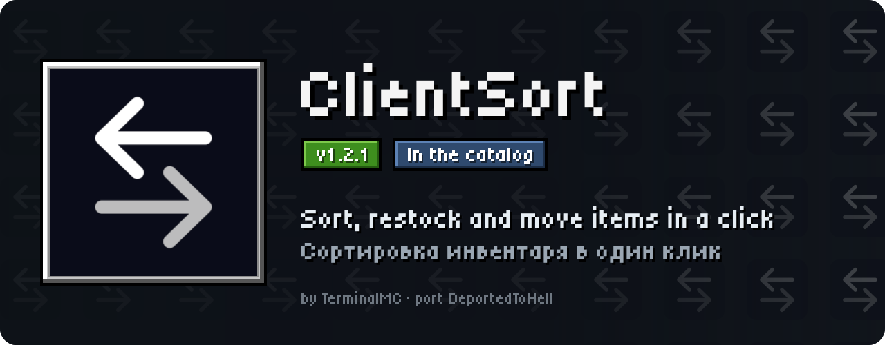
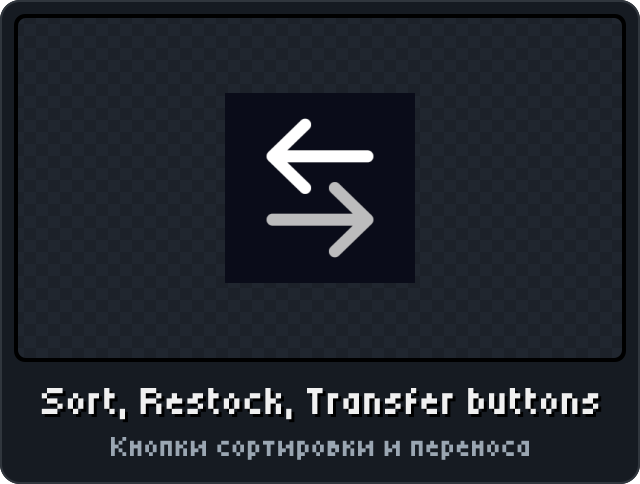
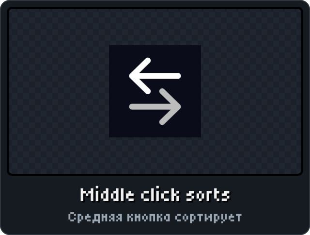
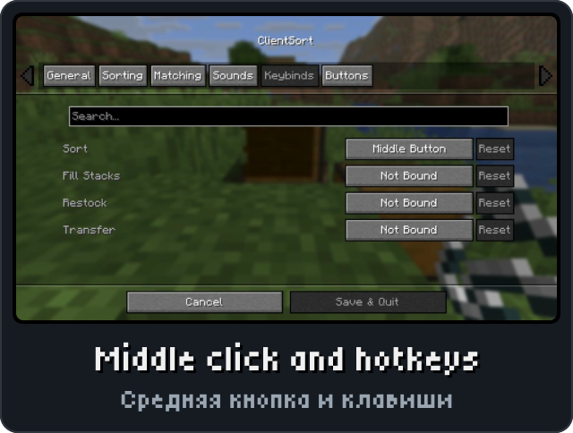
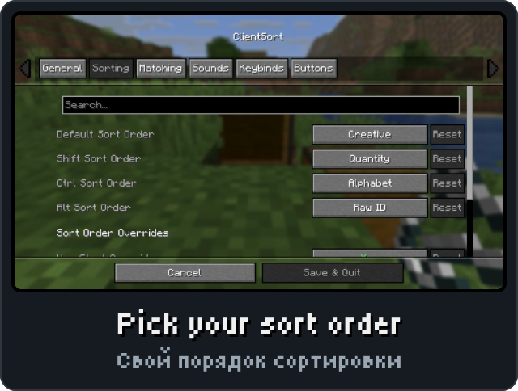

<p align="center"><picture><source media="(max-width: 700px)" srcset="../.github/releases/clientsort/hero-phone.svg"></picture></p>

<p align="center"><a href="https://github.com/DeportedToHell/MCRE-Mods/releases/download/clientsort-1.2.1/clientsort-1.2.1.hnmod"><picture><source media="(max-width: 700px)" srcset="../.github/releases/clientsort/download-phone.svg"></picture></a><br>
<a href="https://playhorizon.dev/mods/clientsort"><picture><source media="(max-width: 700px)" srcset="../.github/releases/clientsort/catalog-phone.svg"></picture></a><br>
<a href="https://github.com/DeportedToHell/MCRE-Mods/releases/tag/clientsort-1.2.1"><picture><source media="(max-width: 700px)" srcset="../.github/releases/clientsort/github-phone.svg"></picture></a></p>

<p align="center"></p>

<p align="center">




</p>

<p align="center"></p>

<p align="center"><picture><source media="(max-width: 700px)" srcset="../.github/releases/common/steps-phone.svg"> Build" width="640"></picture></p>

<details>
<summary><b>All features in detail · Все возможности подробно</b></summary>

A port of [ClientSort](https://github.com/TerminalMC/ClientSort) by TerminalMC to
[Horizon](https://github.com/horizon-rust/horizon), the Rust rewrite of Minecraft: Java Edition 26.3,
as a native mod (`.hnmod`).

### Features

- **Trigger buttons** beside each inventory, as in the original: **Sort**, **Restock** (moves the items the
  other inventory already holds) and **Transfer** (moves as much as fits).
- **Middle click** over an inventory sorts it.
- Sort order: the creative inventory's order by default; hold **Shift** for quantity, **Ctrl** for name
  (A-Z), **Alt** for item ID (each one can be changed in the config screen).
- The container, the main inventory and the hotbar are sorted on their own (by default).
- Keys for every operation, including **Fill Stacks** (unbound except Sort).
- **ClientSort's own config screen**, as in Java (Cloth Config): Mod Menu's Configure button, or
  Options > Mods > ClientSort > **Configure...**. Tabs General, Sorting, Matching, Sounds, Keybinds and
  Buttons, the search field, Reset on every row, tooltips, Cancel / Save & Quit and the "Changes Not
  Saved" question. Its options: interaction interval and server acceleration (instant in single player),
  hotbar scope (its own group, part of the inventory, or left alone), transfer reverse order, the
  default, Shift, Ctrl and Alt sort orders, start and end items, matching by type and the type match
  tags, the interaction sounds, the four keys, the buttons and their tooltips, the buttons' order.
  Russian texts when the game is in Russian.
- Horizon's own "≡" sort buttons are hidden while ClientSort's are shown.

Every action is an ordinary container click, so it works on servers too.

</details>

<details>
<summary><b>Install by hand and source code · Установка вручную и исходный код</b></summary>

### Install

From the launcher: Mods, find **ClientSort**, Install, then Native build > Build.

By hand: put `clientsort-<version>.hnmod` in `<game folder>/horizon-native-mods/`, add the line
`mod.clientsort:true` to `horizon-mods.txt`, then Native build > Build in the launcher.

Native mods are compiled into the game and are not sandboxed: build only code you trust.

### Source layout

```
horizon-native.json            bundle manifest (id, version, pinned Horizon and horizon-mixins revisions)
mixins/clientsort/
  horizon-mixin.toml           modules and injections
  runtime.rs                   the mod's logic, no game types (unit tests)
  glue.rs                      reads and clicks the game's inventory
  cloth.rs                     Cloth Config's config screen (reusable)
  cloth_sprites.rs             Cloth Config's texture as pixels (tools/sprites.mjs makes it)
  config.rs                    ClientSort's tabs and options in it, Mod Menu's Configure
  data/icon.png                the mod's icon, for Mod Menu
  *.rs                         one small helper per injection
  LICENSE, NOTICE
Cargo.toml                     runs runtime.rs's tests
tools/                         check.sh (build into Horizon), package.mjs (make the .hnmod), sprites.mjs
```

The `.hnmod` file is a zip of `horizon-native.json` and `mixins/`.

Tests: `cargo test` (Rust 1.99.1, edition 2024).

Built for Horizon `fdc87aecdbd116bf1e08adcd062fcbaea8c2e2ca` (Nightly 2026-11-08) and horizon-mixins
`5a64af938ec86b00d53d16a408aabc0038fb3e57`.

</details>

<p align="center"><a href="https://github.com/DeportedToHell/MCRE-Mods/tree/main/clientsort"><picture><source media="(max-width: 700px)" srcset="../.github/releases/common/code-phone.svg"></picture></a> <a href="https://github.com/DeportedToHell/MCRE-Mods/issues/new/choose"><picture><source media="(max-width: 700px)" srcset="../.github/releases/common/bug-phone.svg"></picture></a></p>

## Licence and credits

Apache License 2.0, as the original ([LICENSE](LICENSE), [NOTICE](NOTICE)), except the config screen:
`mixins/clientsort/cloth.rs` and `cloth_sprites.rs` follow Cloth Config and are under the GNU LGPL-3.0
([LICENSE.LGPL-3.0](LICENSE.LGPL-3.0), with the GPL-3.0 it builds on in [LICENSE.GPL-3.0](LICENSE.GPL-3.0)).

- ClientSort: Copyright 2024-2026 TerminalMC, https://github.com/TerminalMC/ClientSort
- ClientSort uses code from Mouse Wheelie by Siphalor (Apache-2.0) and Inventory Management by
  Roundaround (MIT).
- The button sprites are ClientSort's own textures.

This port rewrites ClientSort's logic in Rust for Horizon's native mod API. Changes from the original:
the Fill Stacks button is a key only; the buttons keep ClientSort's default layout. The config screen
leaves out what this port doesn't do: the Policies tab and the in-game editor (with its key and Cancel
Auto Operation's), automatic operations and their delays, client fallback, creative sorting's cache,
extra slots, bundles on old servers, debug info, and the buttons' anchor, justification, direction and
offset. The config screen follows Cloth Config by shedaniel (LGPL-3.0) and draws its texture. Not
affiliated with TerminalMC, Mojang or Microsoft.

---

**По-русски.** Порт мода ClientSort для Horizon: кнопки сортировки, пополнения и переноса у каждого
инвентаря, сортировка средней кнопкой мыши (Shift — по количеству, Ctrl — по алфавиту, Alt — по ID).
Экран настроек как в Java (Cloth Config): кнопка «Настройки...» в Mod Menu или Настройки > Моды >
ClientSort > «Настройки...» — вкладки Общие, Сортировка, Сопоставление, Звук, Назначение клавиш, Кнопки.
