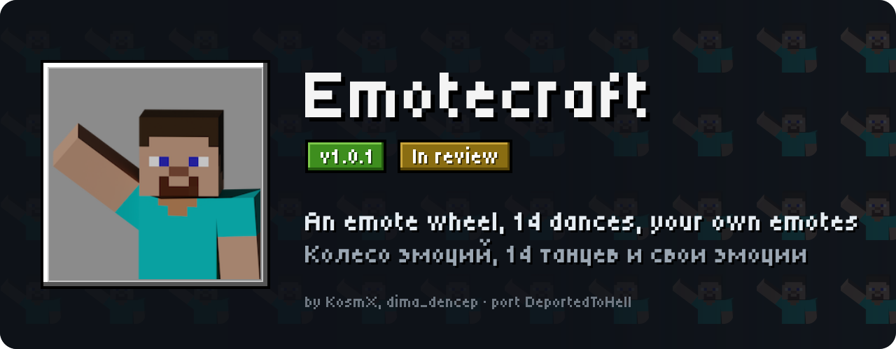
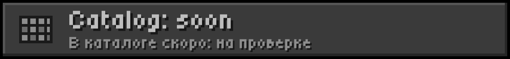
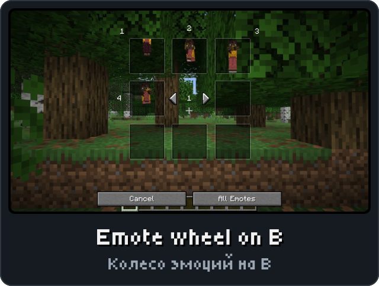
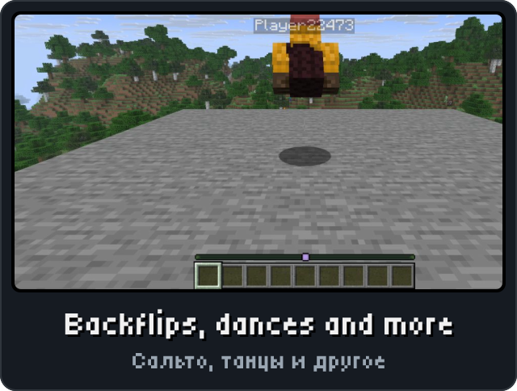
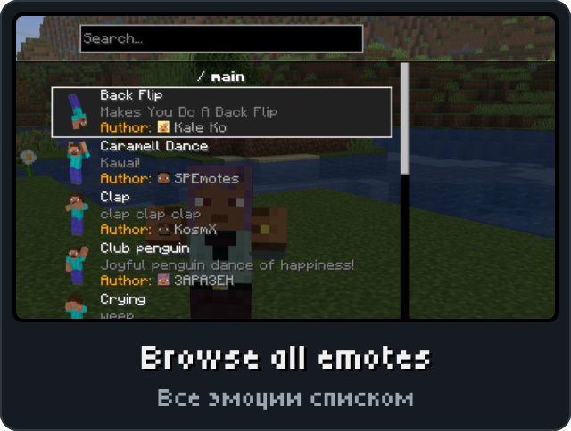
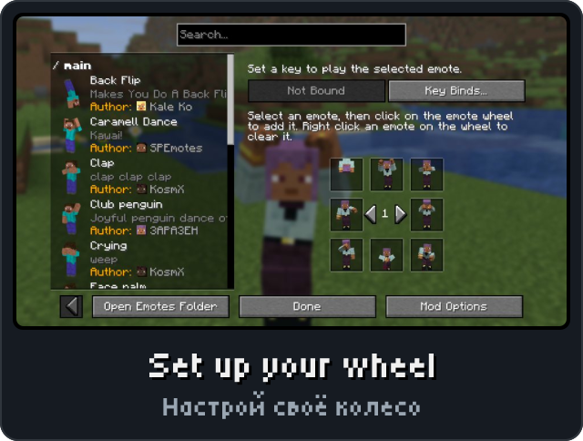

<picture><source media="(max-width: 700px)" srcset="../.github/releases/emotecraft/hero-phone.svg"></picture>

<a href="https://github.com/DeportedToHell/MCRE-Mods/releases/download/emotecraft-1.0.1/emotecraft-1.0.1.hnmod"><picture><source media="(max-width: 700px)" srcset="../.github/releases/emotecraft/download-phone.svg"></picture></a> 
<a href="https://playhorizon.dev/mods"><picture><source media="(max-width: 700px)" srcset="../.github/releases/emotecraft/catalog-phone.svg"></picture></a> 
<a href="https://github.com/DeportedToHell/MCRE-Mods/releases/tag/emotecraft-1.0.1"><picture><source media="(max-width: 700px)" srcset="../.github/releases/emotecraft/github-phone.svg"></picture></a>

<picture><source media="(max-width: 700px)" srcset="../.github/releases/common/steps-phone.svg"> Build" width="640"></picture>

<b>All features in detail · Все возможности подробно</b>

A port of [Emotecraft](https://github.com/KosmX/emotes) 3.5.0 by KosmX and dima_dencep
to Horizon (Minecraft Java Edition 26.3 in Rust), as the native mod `emotecraft`.

- **Client**: the emote wheel (B), All Emotes, Emotes config (wheel pages, key binds),
  Key Binds, Mod Options, Export, toasts, the emote previews, songs, first person,
  English and Russian.
- **Server**: the same mod is Emotecraft's server on a dedicated Horizon server, in
  LAN and in single player (`/emotes play|stop|reload`, the server's `emotes` folder).
- **Java servers**: talks to Java servers running Emotecraft (Fabric/NeoForge mod or
  Paper plugin), over the play-phase handshake.

Not ported: Online Emotes and the cloud library (their buttons stay as Emotecraft shows
them when the service is unavailable), Geyser.

Custom emotes go in `emotes/` in the game folder (Emotecraft `.json`, Blockbench /
Bedrock `.json`, `.emotecraft` binary, with `.png` icons and `.ogg`/`.opus` songs).

<b>Install by hand and source code · Установка вручную и исходный код</b>

### Layout

- `horizon-native.json` — the catalog manifest.
- `mixins/emotecraft/` — the bundle: `horizon-mixin.toml`, the game-side modules
  (`glue.rs`, `server.rs`, `ui.rs`, `lang.rs`, `icons.rs`, `preview.rs`, `songs.rs`,
  `pose.rs`, `atlas.rs`), one-line hook helpers `h_*.rs`, `data/` and the `engine/`
  crate (animation player, formats, protocol, server logic, Opus).
- `tools/lang.mjs` regenerates `engine/src/lang.rs` from Emotecraft's lang files;
  `tools/package.mjs` builds `mods/emotecraft-<version>.hnmod`.

<a href="https://github.com/DeportedToHell/MCRE-Mods/tree/main/emotecraft/mixins/emotecraft"><picture><source media="(max-width: 700px)" srcset="../.github/releases/common/code-phone.svg"></picture></a> <a href="https://github.com/DeportedToHell/MCRE-Mods/issues/new?template=bug-emotecraft.yml"><picture><source media="(max-width: 700px)" srcset="../.github/releases/common/bug-phone.svg"></picture></a>

## Licence

GPL-3.0-only (`LICENSE`). Emotecraft © KosmX, dima_dencep and contributors; Horizon
port © 2026 DeportedToHell. Third-party notices and the statement of changes: `NOTICE`.
Issues: https://github.com/DeportedToHell/MCRE-Mods/issues
