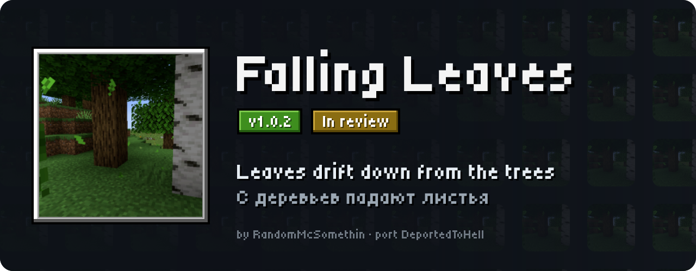
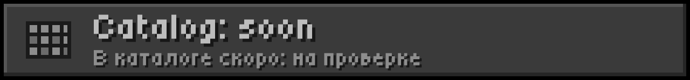
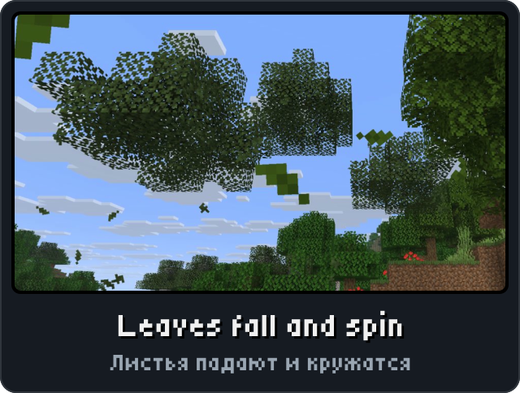
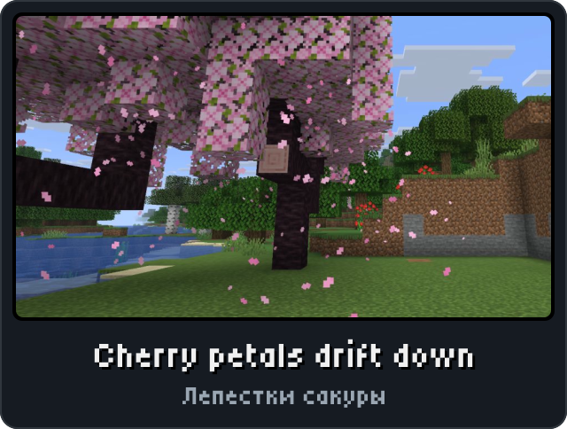
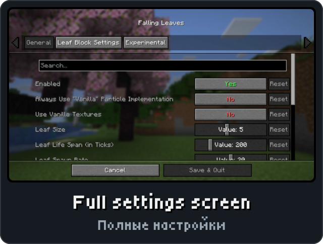

<p align="center"><picture><source media="(max-width: 700px)" srcset="../.github/releases/fallingleaves/hero-phone.svg"></picture></p>

<p align="center"><a href="https://github.com/DeportedToHell/MCRE-Mods/releases/download/fallingleaves-1.0.1/fallingleaves-1.0.1.hnmod"><picture><source media="(max-width: 700px)" srcset="../.github/releases/fallingleaves/download-phone.svg"></picture></a><br>
<a href="https://playhorizon.dev/mods"><picture><source media="(max-width: 700px)" srcset="../.github/releases/fallingleaves/catalog-phone.svg"></picture></a><br>
<a href="https://github.com/DeportedToHell/MCRE-Mods/releases/tag/fallingleaves-1.0.1"><picture><source media="(max-width: 700px)" srcset="../.github/releases/fallingleaves/github-phone.svg"></picture></a></p>

<p align="center"></p>

<p align="center">



</p>

<p align="center"></p>

<p align="center"><picture><source media="(max-width: 700px)" srcset="../.github/releases/common/steps-phone.svg"> Build" width="640"></picture></p>

<details>
<summary><b>All features in detail · Все возможности подробно</b></summary>

A port of [Falling Leaves](https://github.com/RandomMcSomethin/fallingleaves) by RandomMcSomethin (Fourmisain,
BrekiTomasson, RandomMcSomethin) to [Horizon](https://github.com/horizon-rust/horizon), the Rust rewrite of
Minecraft: Java Edition 26.3, as a native mod (`.hnmod`). Leaves fall from the trees, spin, drift with the wind,
float on water and settle on the ground.

### Features

- **Falling leaves** below leaf blocks, with Falling Leaves' own textures, tinted with the colour of the tree's
  leaves (the leaf texture's average colour times the biome's foliage colour), spinning as they fall, faster or
  slower from leaf to leaf, and fading out at the end of their life.
- **Wind**: calm, windy or stormy, changing every few minutes and with the weather (rain makes it windier, a
  thunderstorm stormy), turning slowly; none in the Nether and the End (Windless Dimensions).
- Leaves **float on water**, drift with its current, burn up in lava with a lava spark, rain weighs them down,
  and they stay where they land.
- **Snowflakes** fall from trees in snowy biomes or under snow.
- **Hitting a leaf block** drops a few leaves (and a little snow); a **decaying leaf block** bursts into leaves
  (single player, as in the original).
- Per tree defaults as in the original: conifers (spruce) use the conifer leaves and their own rate (off by
  default), jungle leaves drop none, cherry and pale oak keep the game's own petals and leaves at the mod's rate
  ("Vanilla" implementation), the others are replaced by the mod's leaves.
- **Falling Leaves' config screen**, as in Java (Cloth Config's AutoConfig screen): Configure... on Options > Mods
  > Falling Leaves, or Configure in [Mod Menu](../modmenu). The General, Leaf Block Settings and Experimental tabs,
  sliders, Yes/No buttons, number fields and lists with Reset beside each, tooltips, search, and one section per
  leaf block (Particle Implementation, Spawn Rate Multiplier, drops on hit or decay). Discard Changes / Save &
  Quit and the "Changes Not Saved" question.
- Kept as Falling Leaves keeps it: `config/fallingleaves2.json`.
- English and Russian, as the game's language (Falling Leaves' own translations; where its Russian file has no
  line, the English one, as in Java). Mod Menu shows Falling Leaves' icon and details.

Differences from the original, where Horizon has no counterpart: "Register Leaf Particles" changes nothing (there
is no `/particle fallingleaves:...` type to register); the fall and winter multipliers wait for a seasons mod
(there is none for Horizon); leaf textures a resource pack adds for a single block
(`particles/block/<namespace>/<block>.json`) are not read; in the Leaf Block Settings each block's tooltip names
its namespace's game or mod as Horizon knows it.

</details>

<details>
<summary><b>Install by hand and source code · Установка вручную и исходный код</b></summary>

### Install

From the launcher: Mods, find **Falling Leaves**, Install, then Native build > Build.

By hand: put `fallingleaves-<version>.hnmod` in `<game folder>/horizon-native-mods/`, add the line
`mod.fallingleaves:true` to `horizon-mods.txt`, then Native build > Build in the launcher.

Native mods are compiled into the game and are not sandboxed: build only code you trust.

### Source layout

```
horizon-native.json            bundle manifest (id, version, pinned Horizon and horizon-mixins revisions)
mixins/fallingleaves/
  horizon-mixin.toml           modules and injections
  particle.rs                  the leaf particle (FallingLeafParticle), inside Horizon's particle engine
  core.rs                      the settings and their file, each leaf block's defaults, the wind, where leaves
                               and snowflakes start; beside the game's ambient block tick
  glue.rs                      the game side: the wind's tick, leaf colours, hits, decay, the textures, Options > Mods
  screen.rs                    Falling Leaves' config screen; cloth.rs draws it as Cloth Config does
  cloth.rs, cloth_sprites.rs   Cloth Config's screen and its texture as pixels (tools/sprites.mjs makes it)
  h_*.rs, list.rs, ...         one small helper per injection
  data/icon.png                Falling Leaves' icon, for Mod Menu
  data/tiles.rgba              Falling Leaves' particle textures side by side (tools/tiles.mjs makes it)
  LICENSE, NOTICE
tools/                         check.sh (build into the pinned Horizon), package.mjs, sync.mjs, tiles.mjs,
                               sprites.mjs, png.mjs, textures/ (the original's particle textures)
```

The `.hnmod` file is a zip of `horizon-native.json` and `mixins/`.

Built for Horizon `fdc87aecdbd116bf1e08adcd062fcbaea8c2e2ca` (Nightly 2026-11-08) and horizon-mixins
`5a64af938ec86b00d53d16a408aabc0038fb3e57`.

</details>

<p align="center"><a href="https://github.com/DeportedToHell/MCRE-Mods/tree/main/fallingleaves"><picture><source media="(max-width: 700px)" srcset="../.github/releases/common/code-phone.svg"></picture></a> <a href="https://github.com/DeportedToHell/MCRE-Mods/issues/new/choose"><picture><source media="(max-width: 700px)" srcset="../.github/releases/common/bug-phone.svg"></picture></a></p>

## Licence and credits

MIT, as the original ([LICENSE](LICENSE), [NOTICE](NOTICE)), except the settings screen: `mixins/fallingleaves/cloth.rs`
and `cloth_sprites.rs` follow Cloth Config and are under the GNU LGPL-3.0 ([LICENSE.LGPL-3.0](LICENSE.LGPL-3.0), with the
GPL-3.0 it builds on in [LICENSE.GPL-3.0](LICENSE.GPL-3.0)).

- Falling Leaves: Copyright (c) 2020 RandomMcSomethin, https://github.com/RandomMcSomethin/fallingleaves
- The particle textures and the icon are Falling Leaves' own.
- The config screen follows Cloth Config by shedaniel (LGPL-3.0) and draws its texture.

This port rewrites Falling Leaves' particles, wind, spawning and settings in Rust for Horizon's native mod API.
Not affiliated with RandomMcSomethin, Mojang or Microsoft.

---

**По-русски.** Порт мода Falling Leaves для Horizon: с деревьев падают листья, кружатся, их сносит ветер, они
плавают на воде и остаются лежать на земле; со снежных деревьев сыплется снег. Экран настроек как в Java (Cloth
Config): кнопка «Настройки...» в Mod Menu или Настройки > Моды > Falling Leaves > «Настройки...» — вкладки
Общее, Настройки блока листьев, Экспериментальное.
