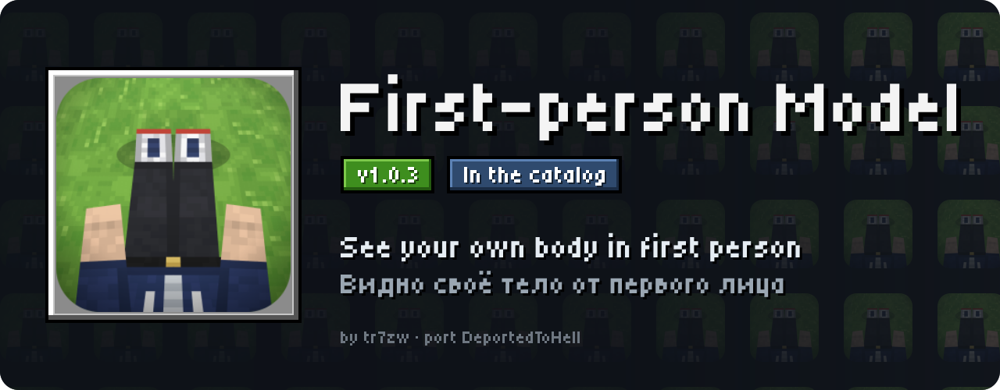
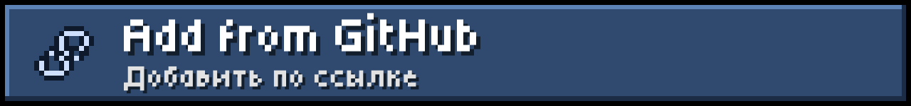
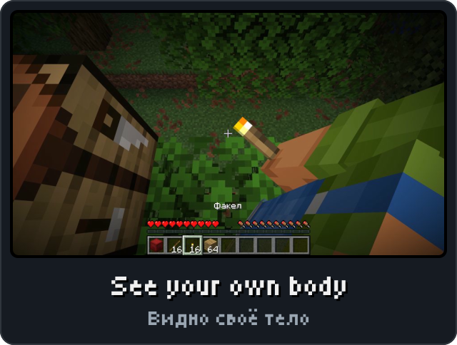
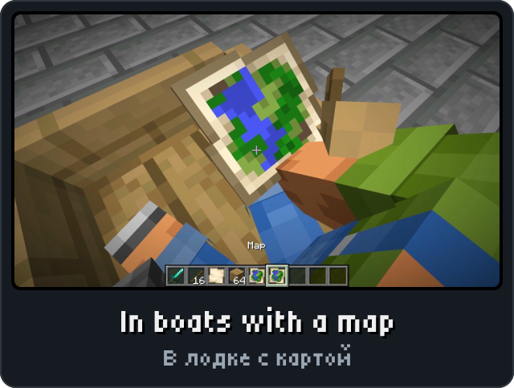
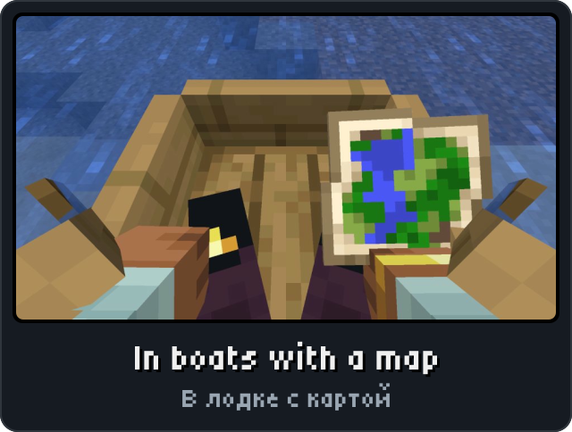
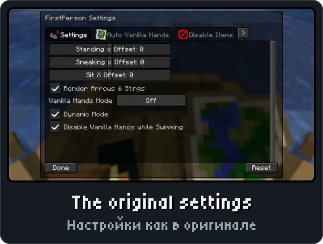

<p align="center"><picture><source media="(max-width: 700px)" srcset="../.github/releases/firstpersonmodel/hero-phone.svg"></picture></p>

<p align="center"><a href="https://github.com/DeportedToHell/MCRE-Mods/releases/download/firstpersonmodel-1.0.3/firstpersonmodel-1.0.3.hnmod"><picture><source media="(max-width: 700px)" srcset="../.github/releases/firstpersonmodel/download-phone.svg"></picture></a><br>
<a href="https://playhorizon.dev/mods/firstpersonmodel"><picture><source media="(max-width: 700px)" srcset="../.github/releases/firstpersonmodel/catalog-phone.svg"></picture></a><br>
<a href="https://github.com/DeportedToHell/MCRE-Mods/releases/tag/firstpersonmodel-1.0.3"><picture><source media="(max-width: 700px)" srcset="../.github/releases/firstpersonmodel/github-phone.svg"></picture></a></p>

<p align="center"></p>

<p align="center">




</p>

<p align="center"></p>

<p align="center"><picture><source media="(max-width: 700px)" srcset="../.github/releases/common/steps-phone.svg"> Build" width="640"></picture></p>

<details>
<summary><b>All features in detail · Все возможности подробно</b></summary>

A port of [First-person Model](https://github.com/tr7zw/FirstPersonModel) (FirstPerson) by tr7zw to
[Horizon](https://github.com/horizon-rust/horizon), the Rust rewrite of Minecraft: Java Edition 26.3,
as a native mod (`.hnmod`). You see your own third-person body in first person, as with the original.

### Features

- **Your body in first person**: the player model you see in third person, drawn behind the camera
  (0.25 blocks back along the body's yaw) with the head and hat hidden. Your armour, cape, elytra,
  held items, parrots, arrows and bee stingers show on it, and so do your fire and Horizon's
  cosmetics companions.
- **Offsets for every pose**: standing, sneaking, sitting (boats, minecarts, mounts; a living mount
  turns your body with its own), crawling and swimming (the body follows the head, and moves up or down
  with your pitch under water). The standing, sneaking and sitting offsets can be changed.
- **The mod steps aside** while sleeping, gliding with an elytra, spinning with Riptide, half
  swimming, scoping with a spyglass, and while you hold an item of the "Disable Items" list.
- **Vanilla Hands Mode**: Off (only the body), Always, Always Both Hands (the empty off hand shows its
  arm too) or Item In Hand. **Dynamic Mode** shows the body's arms and lowers the vanilla hands when you
  look down. "Disable Vanilla Hands while Swimming".
- **Auto Vanilla Hands**: items that switch to the vanilla hands while held (the original's list of
  modded maps and tools). **Disable Items**: items that turn the mod off while held.
- **Show Layers**: hide any of the body's layers (armour, held items, arrows, ears, cape, head items,
  wings, parrots, Riptide, bee stingers). **Render Arrows & Stings** on or off.
- The fishing line leaves the body's hand while its arms show.
- **F6** turns the mod on and off (the key can be changed on Options > Mods > FirstPerson).
- **The original's config screen** (TRender's, as First-person Model builds it): the four tabs
  (Settings, Auto Vanilla Hands, Disable Items and Show Layers, reached with the ribbon's `>`), the
  sliders, checkboxes and the hands mode button with their tooltips, the item lists with icons and
  search, Done and Reset. It opens from **Mod Menu** (Configure) and from "Configure..." on
  Options > Mods > FirstPerson. English and Russian, as the original's texts.
- Settings are kept in `config/firstperson.json`, the original's file, in its format.

### Differences from the original

- The original renders the camera entity a second time, moved. Horizon draws the player on the CPU, so
  this port draws Horizon's own player model again from a camera moved the other way. The result is the
  same body in the same place.
- The original's "Auto Vanilla Hands" tab saves into the "Disable Items" list (a bug). Here it saves into
  its own list.
- A hidden layer is hidden on your own body only. The original also hid it on other players who used
  the same model while you were in first person.
- No API for other mods (PlayerAnimator, Freecam). Not Enough Animations is not part of this port.

</details>

<details>
<summary><b>Install by hand and source code · Установка вручную и исходный код</b></summary>

### Install

From the launcher: Mods, find **First-person Model**, Install, then Native build > Build.

By hand: put `firstpersonmodel-<version>.hnmod` in `<game folder>/horizon-native-mods/`, add the line
`mod.firstpersonmodel:true` to `horizon-mods.txt`, then Native build > Build in the launcher.

Native mods are compiled into the game and are not sandboxed: build only code you trust.

### Source layout

```
horizon-native.json            bundle manifest (id, version, pinned Horizon and horizon-mixins revisions)
mixins/firstpersonmodel/
  horizon-mixin.toml           modules and injections
  runtime.rs                   settings (config/firstperson.json), the toggle, LogicHandler's decisions
  glue.rs                      the game's side: the body, its layers, the hands, the fishing line, the key
  pose.rs                      what the body hides (spliced into the client library's mobs::anim)
  gui.rs                       the config screen, as TRender draws it
  screen.rs                    the config screen over the Options screen (Mod Menu), the icon and Mod Menu's metadata
  sprites.rs                   TRender's textures (made by tools/sprites.mjs)
  *.rs (the rest)              one small helper per injection
  data/icon.png                this port's own icon, for Mod Menu
  LICENSE, NOTICE
tools/check.sh                 stages the mod on the pinned Horizon source and cargo-checks (or builds) the game
tools/package.mjs              makes the .hnmod
tools/sprites.mjs              makes sprites.rs from a TRender checkout
```

</details>

<p align="center"><a href="https://github.com/DeportedToHell/MCRE-Mods/tree/main/firstpersonmodel/mixins/firstpersonmodel"><picture><source media="(max-width: 700px)" srcset="../.github/releases/common/code-phone.svg"></picture></a> <a href="https://github.com/DeportedToHell/MCRE-Mods/issues/new?template=bug-first-person-model.yml"><picture><source media="(max-width: 700px)" srcset="../.github/releases/common/bug-phone.svg"></picture></a></p>

## Licence

MIT, as First-person Model and TRender: see `LICENSE` and `NOTICE`. First-person Model is tr7zw's mod and
this port's code follows it. The icon is this port's own (since 1.0.2), not First-person Model's. Not
affiliated with tr7zw, Mojang or Microsoft.
