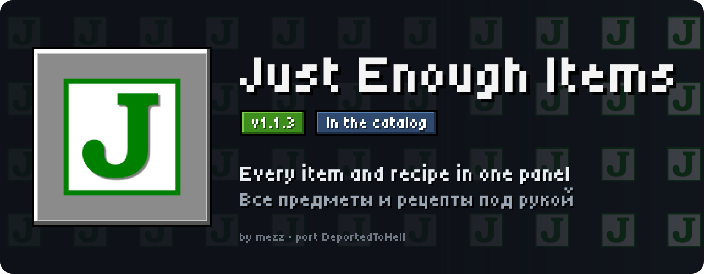
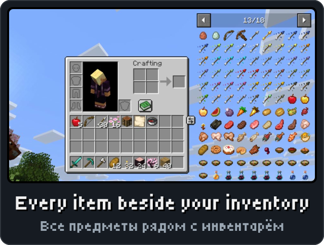
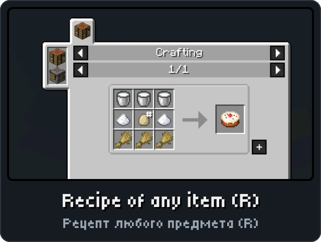
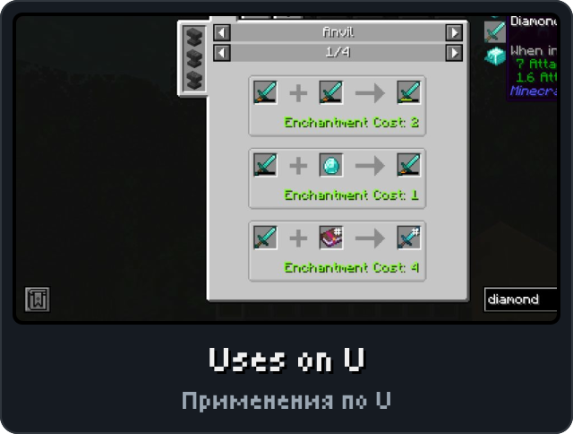
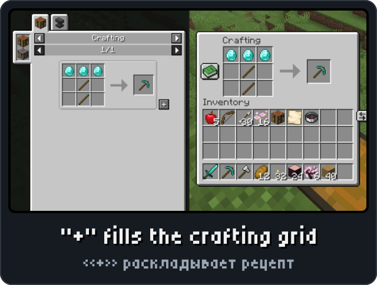

<p align="center"><picture><source media="(max-width: 700px)" srcset="../.github/releases/justenoughitems/hero-phone.svg"></picture></p>

<p align="center"><a href="https://github.com/DeportedToHell/MCRE-Mods/releases/download/justenoughitems-1.1.3/justenoughitems-1.1.3.hnmod"><picture><source media="(max-width: 700px)" srcset="../.github/releases/justenoughitems/download-phone.svg"></picture></a><br>
<a href="https://playhorizon.dev/mods/justenoughitems"><picture><source media="(max-width: 700px)" srcset="../.github/releases/justenoughitems/catalog-phone.svg"></picture></a><br>
<a href="https://github.com/DeportedToHell/MCRE-Mods/releases/tag/justenoughitems-1.1.3"><picture><source media="(max-width: 700px)" srcset="../.github/releases/justenoughitems/github-phone.svg"></picture></a></p>

<p align="center"></p>

<p align="center">




</p>

<p align="center"></p>

<p align="center"><picture><source media="(max-width: 700px)" srcset="../.github/releases/common/steps-phone.svg"> Build" width="640"></picture></p>

<details>
<summary><b>All features in detail · Все возможности подробно</b></summary>

A port of [Just Enough Items (JEI)](https://github.com/mezz/JustEnoughItems) by mezz to
[Horizon](https://github.com/horizon-rust/horizon), the Rust rewrite of Minecraft: Java Edition 26.3,
as a native mod (`.hnmod`). It draws JEI's own interface, with JEI's sprites, over the game's container
screens.

### Features

- **Ingredient list** right of every container screen and the creative inventory: every item, the
  creative inventory's subtypes (enchanted books, potions, tipped arrows...) included, in pages; the mouse
  wheel or the arrows turn them.
- **Search** with JEI's grammar: words (the name, and the tooltip), `"quoted phrases"`, `-exclusions`,
  `a | b` alternatives, `@mod`, `#tooltip`, `$tag`, `%creative tab`, `&id`.
- **Recipes and uses**: left click (or **R**) shows how an item is made, right click (or **U**) what it is
  used for, over the list, the bookmarks, a recipe's slots or any slot of the screen.
- **Recipes screen** as JEI's: category tabs with their station's icon, catalysts at its left, pages,
  cycling ingredients, a click on the category's name for all its recipes, **Backspace** back, **Esc** or
  **E** to close. Categories, laid out with JEI's own sizes and sprites: crafting (shaped and
  shapeless, plus JEI's tipped arrows, firework rockets and shield patterns), stonecutting, smelting
  (with the "any fuel" slot), smoking, blasting, campfire cooking, fuel for each furnace, brewing (with
  its steps from a water bottle), anvil (repairs and every enchanted book, with their cost), grindstone
  (repairs and disenchanting, with the experience back), smithing, composting.
- **"+" moves a recipe** into the crafting grid (inventory or crafting table); with Shift, as many as
  the items allow. It moves the items with ordinary slot clicks, so it works on any server, and tells
  you when items are missing.
- **Bookmarks** left of the screen: **A** over an item adds or removes it; kept in
  `config/justenoughitems/bookmarks.txt`.
- **Cheat mode** (Ctrl+click on the config button, or its key): a click on the list gives the item (a
  stack, or one with the right button); in creative as the creative inventory does, elsewhere with
  `/give`.
- **Ctrl+O** hides or shows the overlays, **Ctrl+F** selects the search bar, **Page Up / Page Down** turn
  pages.
- The mod's name at the foot of JEI's item tooltips, blue and italic, as JEI adds it.
- The overlays keep clear of the recipe book, the inventory's effect bars and the toasts.
- **JEI's config screen** (MezzConfig GUI's, as JEI 26.3 opens it): from the config button, from Mod
  Menu's Configure and from the first button of Options > Mods > Just Enough Items: the category tree,
  search, check boxes and drop-down lists with reset buttons, Undo, the info panel; the window and the
  category column resize. It shows the settings this port has (lists, bookmark placement, search bar
  position, the search prefixes' modes, cheat mode).
- Settings on Options > Mods > Just Enough Items; keys there too. Russian labels when the game is in
  Russian.

Turn other recipe viewers (Horizon's "Recipes", "JEI for Horizon") off while this one is on: they use the
same place on screen.

</details>

<details>
<summary><b>Install by hand and source code · Установка вручную и исходный код</b></summary>

### Install

From the launcher: Mods, find **Just Enough Items**, Install, then Native build > Build.

By hand: put `justenoughitems-<version>.hnmod` in `<game folder>/horizon-native-mods/`, add the line
`mod.justenoughitems:true` to `horizon-mods.txt`, then Native build > Build in the launcher.

Native mods are compiled into the game and are not sandboxed: build only code you trust.

### Recipe categories from other mods

Another native mod can add a recipe category (JEI's `IRecipeCategory` with its recipes), shown after
JEI's own. Register it from the mod's module, at any time (JEI makes its tables again the next frame):

```rust
crate::game::justenoughitems_glue::register_category(crate::game::justenoughitems_glue::PluginCategory {
    id: "mymod:category",                       // once per id
    title: |_game| "My Category".to_owned(),    // in the game's language
    width: 150.0,                               // the recipe's size
    height: 52.0,
    catalysts: &["minecraft:spawner"],          // the tab's icon first; "uses" of one shows every recipe
    recipes: |_game| vec![PluginRecipe {
        inputs: vec![vec!["minecraft:sugar".into()], vec!["minecraft:spawner".into()]],
        outputs: Vec::new(),                    // after an arrow, when there are some
        lines: vec!["Shortest Wait: -0.5s".into()], // text under the slots
    }],
});
```

Each slot lists stacks named as `/give` does, any one of which fits (shown in turn). R and U find a
plugin's recipes by their outputs and inputs, as JEI's own. A mod that should also build without this
JEI (or with an older one) can keep the call behind a check of the staged `game.rs` for
`fn register_category(category: PluginCategory)`.

### Source layout

```
horizon-native.json            bundle manifest (id, version, pinned Horizon and horizon-mixins revisions)
mixins/justenoughitems/
  horizon-mixin.toml           modules and injections
  runtime.rs                   search, lists, recipe lookups, settings: no game types (unit tests)
  config.rs, options.rs        JEI's config screen (MezzConfig GUI's) and its place over the Options screen
  config_sprites.rs            MezzConfig GUI's textures and JEI's icon (made by tools/configsprites.mjs)
  data/icon.png                the icon Mod Menu shows
  glue.rs                      the game's items and recipes, mouse and keys, giving and moving items
  view.rs                      drawing
  sprites.rs                   JEI's sprites as pixel runs (made by tools/sprites.mjs)
  h_*.rs                       one small helper per injection
  LICENSE, NOTICE
tools/check.sh                 stages the mod on the pinned Horizon source and cargo-checks the game
tools/package.mjs              makes the .hnmod
tools/sprites.mjs              makes sprites.rs from a JEI checkout
Cargo.toml                     runs runtime.rs's tests
```

Tests: `cargo test` (Rust 1.99.1, edition 2024).

Built for Horizon `fdc87aecdbd116bf1e08adcd062fcbaea8c2e2ca` (Nightly 2026-11-08) and horizon-mixins
`5a64af938ec86b00d53d16a408aabc0038fb3e57`.

</details>

<p align="center"><a href="https://github.com/DeportedToHell/MCRE-Mods/tree/main/justenoughitems"><picture><source media="(max-width: 700px)" srcset="../.github/releases/common/code-phone.svg"></picture></a> <a href="https://github.com/DeportedToHell/MCRE-Mods/issues/new?template=bug-just-enough-items.yml"><picture><source media="(max-width: 700px)" srcset="../.github/releases/common/bug-phone.svg"></picture></a></p>

## Licence and credits

MIT, as the original ([LICENSE](mixins/justenoughitems/LICENSE),
[NOTICE](mixins/justenoughitems/NOTICE)).

- Just Enough Items: Copyright (c) 2014-2015 mezz, https://github.com/mezz/JustEnoughItems
- The GUI sprites are JEI's own textures.

This port rewrites JEI in Rust for Horizon's native mod API. Changes from the original: JEI's plugin API only as recipe categories (above);
settings on Horizon's mod settings page; the `%` and `&` search prefixes on; colour search and the
item-hiding edit mode not ported. Not affiliated with mezz, Mojang or Microsoft.

---

**По-русски.** Порт JEI для Horizon: список всех предметов справа от инвентаря с поиском, рецепты
(левый клик или R) и применение (правый клик или U), окно рецептов как в JEI, перенос рецепта в сетку
крафта кнопкой «+», закладки (A), режим читов. Настройки: Настройки > Моды > Just Enough Items.
