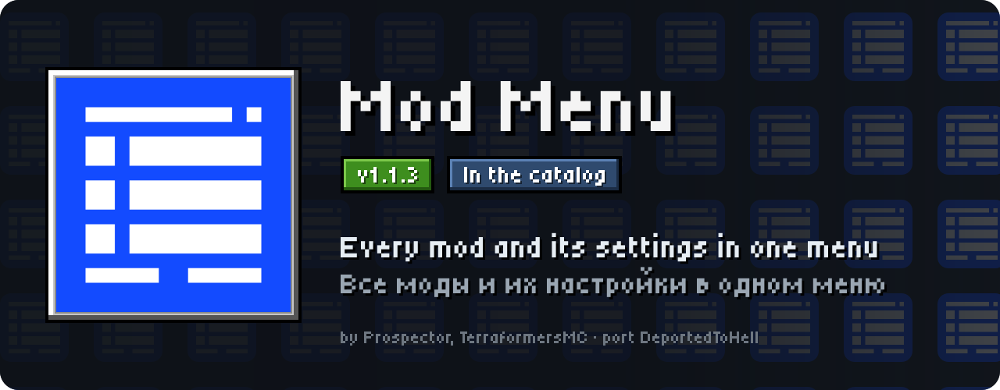
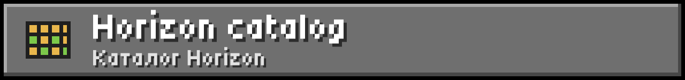
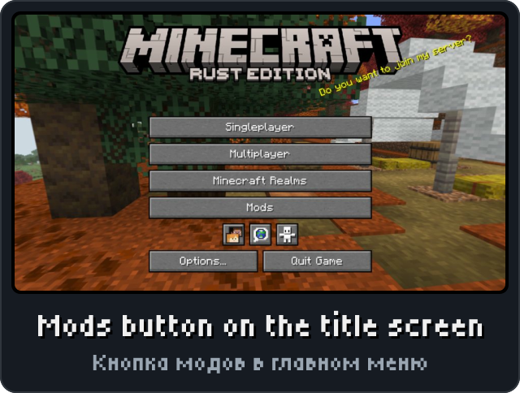
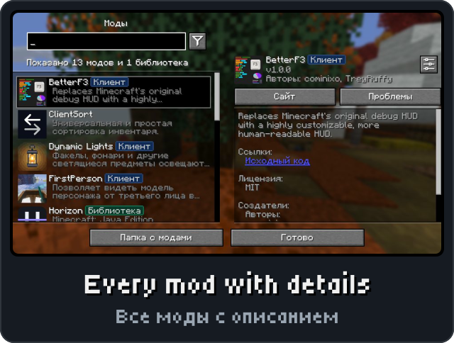
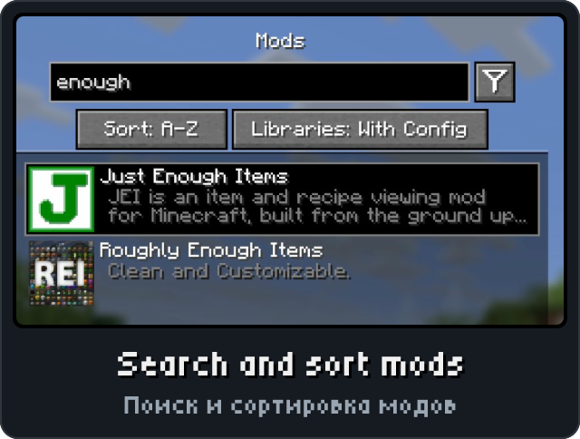
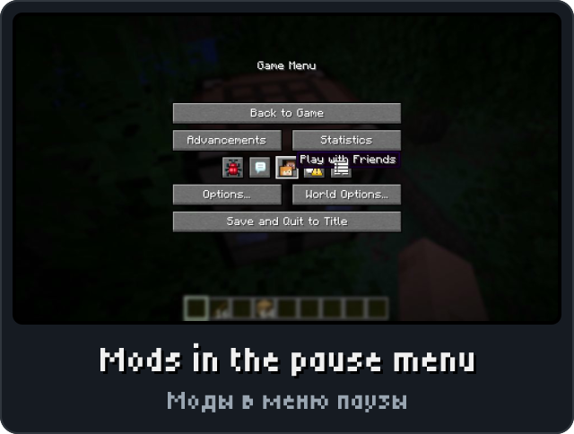

<p align="center"><picture><source media="(max-width: 700px)" srcset="../.github/releases/modmenu/hero-phone.svg"></picture></p>

<p align="center"><a href="https://github.com/DeportedToHell/MCRE-Mods/releases/download/modmenu-1.1.2/modmenu-1.1.2.hnmod"><picture><source media="(max-width: 700px)" srcset="../.github/releases/modmenu/download-phone.svg"></picture></a><br>
<a href="https://playhorizon.dev/mods/modmenu"><picture><source media="(max-width: 700px)" srcset="../.github/releases/modmenu/catalog-phone.svg"></picture></a><br>
<a href="https://github.com/DeportedToHell/MCRE-Mods/releases/tag/modmenu-1.1.2"><picture><source media="(max-width: 700px)" srcset="../.github/releases/modmenu/github-phone.svg"></picture></a></p>

<p align="center"></p>

<p align="center">




</p>

<p align="center"></p>

<p align="center"><picture><source media="(max-width: 700px)" srcset="../.github/releases/common/steps-phone.svg"> Build" width="640"></picture></p>

<details>
<summary><b>All features in detail · Все возможности подробно</b></summary>

A port of [Mod Menu](https://github.com/TerraformersMC/ModMenu) by Prospector and TerraformersMC to
[Horizon](https://github.com/horizon-rust/horizon), the Rust rewrite of Minecraft: Java Edition 26.3, as a
native mod (`.hnmod`). It looks and behaves like Mod Menu, with Mod Menu's own layout and textures.

### Features

- **A Mods button** on the title screen (a fourth icon beside Friends, Language and Accessibility, or
  below, beside or instead of Realms) and in the pause menu (a fifth icon, or a full-width button), with the
  mod count after the version: "Horizon 26.3 (Rust) (12 Mods)".
- **The mods screen**: every mod built into the game, the content mods turned on, Minecraft and Horizon
  itself, each with its icon, name, version, summary and badges (Library, Client, Minecraft).
- **Details** of the selected mod: description, credits (authors, contributors, maintainers), licence, links
  (source, website, issues), and a newer version when Horizon's catalog has one. As in Java, where they come
  from the mod's jar, a mod's icon and details come from the mod itself (see "For mod authors" below), else
  from the catalog's copy beside the game.
- **Search** by name, id, description and author, and Mod Menu's search terms ("lib", "config", "update").
- **Sorting** (A-Z, Z-A, has update) and the **library filter** behind the filter button.
- **Configure** opens the mod's own config screen when it has one, else its page on Options > Mods
  (Minecraft: Options, Horizon: its settings); a click on a row's icon or a double click does the same
  (quick configure). Closing it comes back to the mods screen.
- The **update indicator** on the Mods button when the catalog has a newer version of a mod.
- **Open Mods Folder** opens `horizon-native-mods`.
- **Mod Menu's options**: all 21 of them (sorting, compact list, button styles, mod count, links, licences,
  badges, credits, update indicator, quick configure, …).
- **Open Mod Menu** key on Options > Mods (unbound). English and Russian, Mod Menu's own translations.

</details>

<details>
<summary><b>Install by hand and source code · Установка вручную и исходный код</b></summary>

### For mod authors

A native mod gives Mod Menu its icon, credits and links, and its own config screen, through two files it
writes into its data folder (`native_data_dir(<id>)`, `horizon-mods/.horizon-mod-data/<id>/`) at its first
frame:

- `icon.png`: the mod's icon (compiled in with `native_data!`).
- `modmenu.json`, Java's `fabric.mod.json` for Mod Menu:

  ```json
  {
    "schema": 1,
    "name": "My Mod",
    "version": "1.0.0",
    "description": "English description",
    "description_ru": "Русское описание (optional)",
    "authors": ["Someone"],
    "contributors": ["Someone else"],
    "maintainers": ["Optional"],
    "license": "MIT",
    "links": { "homepage": "https://…", "sources": "https://…", "issues": "https://…" },
    "badges": ["client"],
    "config_screen": true
  }
  ```

With `"config_screen": true`, Configure opens the mod's page on Options > Mods, then calls the mod's
`settings_click` hook with the button `0x4D4D_4346` (`MODMENU_CONFIGURE`): the mod shows its own screen
over the page, and when it closes, leaves the options as Escape does, which brings back the mods screen.

### Install

From the launcher: Mods, find **Mod Menu**, Install, then Native build > Build.

By hand: put `modmenu-<version>.hnmod` in `<game folder>/horizon-native-mods/`, add the line
`mod.modmenu:true` to `horizon-mods.txt`, then Native build > Build in the launcher.

Native mods are compiled into the game and are not sandboxed: build only code you trust.

### Source layout

```
horizon-native.json            bundle manifest (id, version, pinned Horizon and horizon-mixins revisions)
mixins/modmenu/
  horizon-mixin.toml           modules and injections
  runtime.rs                   settings, mods, search, sorting, counts, labels: no game types (unit tests)
  glue.rs                      the mods from the game and the catalog, opening, mouse and keys, icons
  view.rs                      drawing
  title.rs                     the title screen's Mods button, its icon and the mod count (a module of the
                               title's own file, so they show on the startup screen too)
  sprites.rs                   Mod Menu's textures as pixel runs (made by tools/sprites.mjs)
  h_*.rs                       one small helper per injection
  LICENSE, NOTICE
tools/check.sh                 stages the mod on the pinned Horizon source and cargo-checks the game
tools/package.mjs              makes the .hnmod
tools/sprites.mjs              makes sprites.rs from a Mod Menu checkout
Cargo.toml                     runs runtime.rs's tests
```

Tests: `cargo test` (Rust 1.99.1, edition 2024).

</details>

<p align="center"><a href="https://github.com/DeportedToHell/MCRE-Mods/tree/main/modmenu"><picture><source media="(max-width: 700px)" srcset="../.github/releases/common/code-phone.svg"></picture></a> <a href="https://github.com/DeportedToHell/MCRE-Mods/issues/new/choose"><picture><source media="(max-width: 700px)" srcset="../.github/releases/common/bug-phone.svg"></picture></a></p>

## Licence

MIT, as Mod Menu: see `mixins/modmenu/LICENSE` and `NOTICE`. Not affiliated with TerraformersMC, Prospector,
Mojang or Microsoft.
