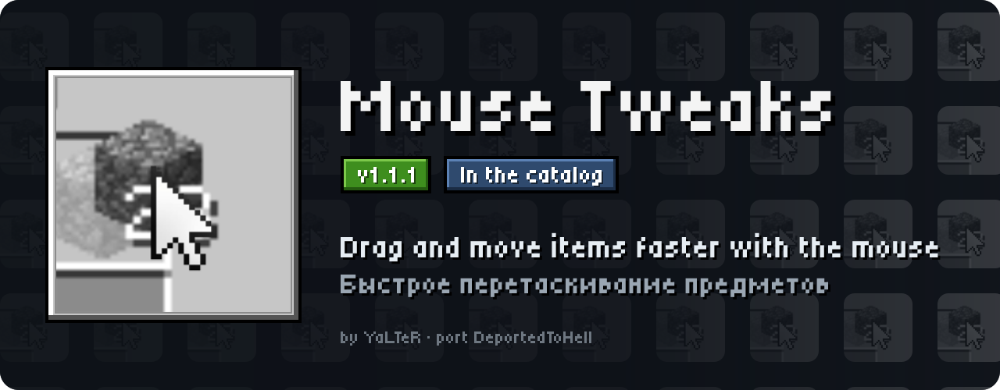
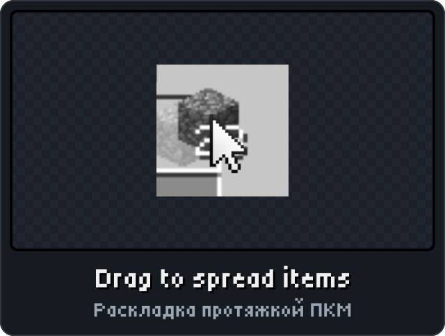
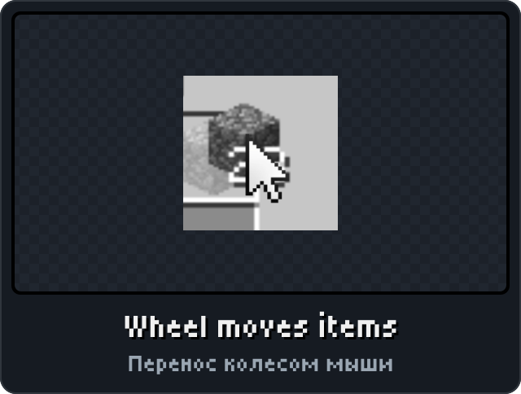
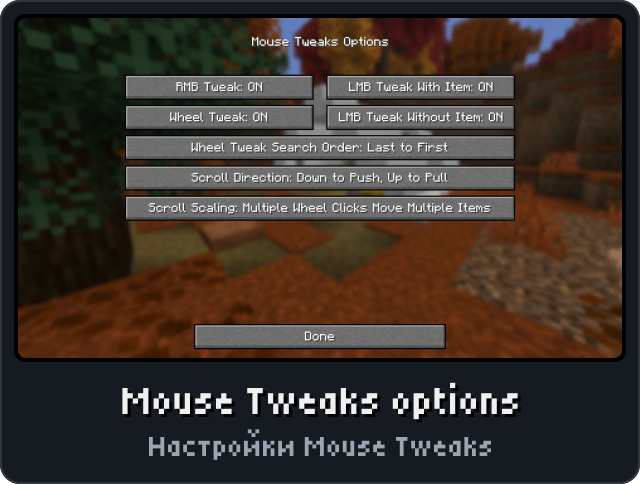

<p align="center"><picture><source media="(max-width: 700px)" srcset="../.github/releases/mousetweaks/hero-phone.svg"></picture></p>

<p align="center"><a href="https://github.com/DeportedToHell/MCRE-Mods/releases/download/mousetweaks-1.1.0/mousetweaks-1.1.0.hnmod"><picture><source media="(max-width: 700px)" srcset="../.github/releases/mousetweaks/download-phone.svg"></picture></a><br>
<a href="https://playhorizon.dev/mods/mousetweaks"><picture><source media="(max-width: 700px)" srcset="../.github/releases/mousetweaks/catalog-phone.svg"></picture></a><br>
<a href="https://github.com/DeportedToHell/MCRE-Mods/releases/tag/mousetweaks-1.1.0"><picture><source media="(max-width: 700px)" srcset="../.github/releases/mousetweaks/github-phone.svg"></picture></a></p>

<p align="center"></p>

<p align="center">



</p>

<p align="center"></p>

<p align="center"><picture><source media="(max-width: 700px)" srcset="../.github/releases/common/steps-phone.svg"> Build" width="640"></picture></p>

<details>
<summary><b>All features in detail · Все возможности подробно</b></summary>

A port of [Mouse Tweaks](https://github.com/YaLTeR/MouseTweaks) by Ivan Molodetskikh (YaLTeR) to
[Horizon](https://github.com/horizon-rust/horizon), the Rust rewrite of Minecraft: Java Edition 26.3,
as a native mod (`.hnmod`).

### Features

The original's tweaks and all seven of its options:

- **RMB drag**: hold the right button with a stack and drag over slots to drop one item into each.
- **LMB drag**: with an item on the cursor, drag to gather the same items; with **Shift**, quick-move
  every slot you pass.
- **LMB drag with an empty hand + Shift**: quick-move every slot you pass.
- **Wheel tweak**: the wheel over a slot moves items one at a time between your inventory and the
  container (crafting results included, even with another item on the cursor). Search order, scroll
  direction (normal, inverted, position-aware) and item scaling as in the original.
- Works on every container screen and the creative inventory (the player's slots). The wheel is left to
  the merchant, stonecutter and loom lists.
- While it is on, it replaces Horizon's built-in Extras > Mouse Tweaks.

- **Mouse Tweaks' own options screen**, as in Java ("Mouse Tweaks Options"): Mod Menu's Configure button,
  or Options > Mods > Mouse Tweaks > **Configure...**. The original's layout and buttons (Shift-click or
  the wheel steps a choice back), Done or Escape to leave; every change is kept at once, as the original
  saves on closing. The page's buttons under Configure... change the same options. Russian labels when
  the game is in Russian.

Every action is an ordinary slot click, so it works on servers too.

</details>

<details>
<summary><b>Install by hand and source code · Установка вручную и исходный код</b></summary>

### Install

From the launcher: Mods, find **Mouse Tweaks**, Install, then Native build > Build.

By hand: put `mousetweaks-<version>.hnmod` in `<game folder>/horizon-native-mods/`, add the line
`mod.mousetweaks:true` to `horizon-mods.txt`, then Native build > Build in the launcher.

Native mods are compiled into the game and are not sandboxed: build only code you trust.

### Source layout

```
horizon-native.json            bundle manifest (id, version, pinned Horizon and horizon-mixins revisions)
mixins/mousetweaks/
  horizon-mixin.toml           modules and injections
  runtime.rs                   the tweaks, no game types (unit tests)
  glue.rs                      the game's menu as the tweaks see it
  screen.rs                    the options screen (`ConfigScreen`), Mod Menu's Configure
  data/icon.png                the mod's icon, for Mod Menu
  *.rs                         one small helper per injection
  LICENSE, NOTICE
Cargo.toml                     runs runtime.rs's tests
tools/                         check.sh (build into Horizon), package.mjs (make the .hnmod)
```

The `.hnmod` file is a zip of `horizon-native.json` and `mixins/`.

Tests: `cargo test` (Rust 1.99.1, edition 2024).

Built for Horizon `fdc87aecdbd116bf1e08adcd062fcbaea8c2e2ca` (Nightly 2026-11-08) and horizon-mixins
`5a64af938ec86b00d53d16a408aabc0038fb3e57`.

</details>

<p align="center"><a href="https://github.com/DeportedToHell/MCRE-Mods/tree/main/mousetweaks/mixins/mousetweaks"><picture><source media="(max-width: 700px)" srcset="../.github/releases/common/code-phone.svg"></picture></a> <a href="https://github.com/DeportedToHell/MCRE-Mods/issues/new?template=bug-mouse-tweaks.yml"><picture><source media="(max-width: 700px)" srcset="../.github/releases/common/bug-phone.svg"></picture></a></p>

## Licence and credits

BSD 3-Clause License, as the original ([LICENSE](LICENSE), [NOTICE](NOTICE)).

- Mouse Tweaks: Copyright (c) 2023, Ivan Molodetskikh, https://github.com/YaLTeR/MouseTweaks

This port rewrites Mouse Tweaks' logic (`Main.java`, `Config.java`, original commit
`e8ecd08ed94192f6f19d3cbb630707c8670a4d66`) in Rust for Horizon's native mod API. Its settings live on a
Horizon settings page instead of `MouseTweaks.cfg`; its options screen is `ConfigScreen.java`'s, without
the Debug Mode row (the port keeps no debug log). Not affiliated with Ivan Molodetskikh, Mojang or
Microsoft.

---

**По-русски.** Порт Mouse Tweaks для Horizon: протяжка правой кнопкой (по одному предмету в слот),
протяжка левой (собрать одинаковые, с Shift — быстро переложить), колесо над слотом перекладывает
предметы по одному. Настройки: кнопка настроек мода в Mod Menu или Настройки > Моды > Mouse Tweaks >
«Настройки...» — экран настроек как в оригинале.
