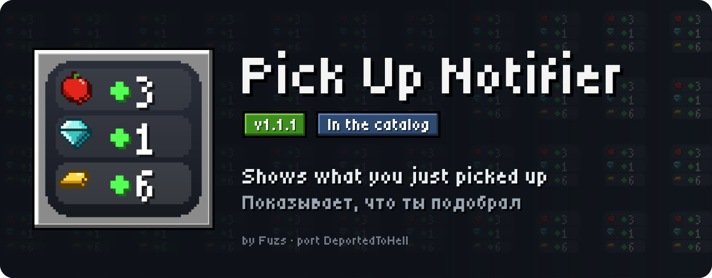
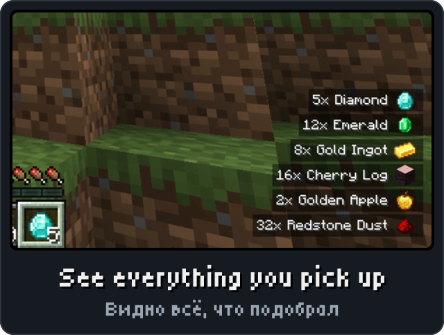
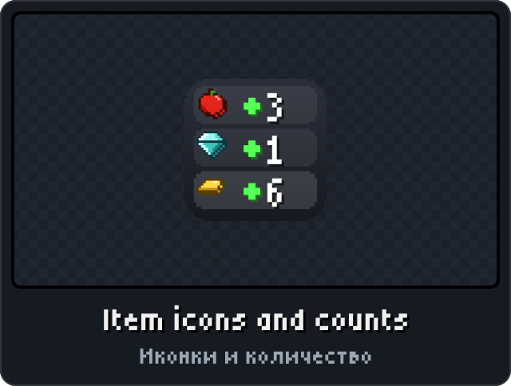
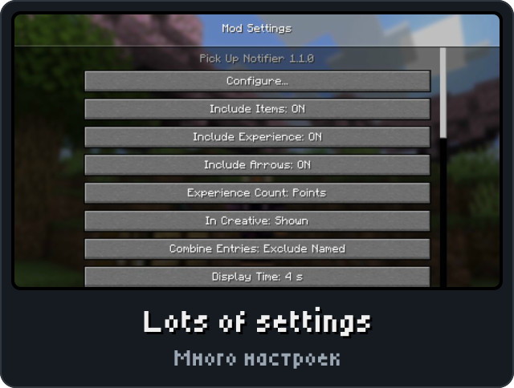

<picture><source media="(max-width: 700px)" srcset="../.github/releases/pickupnotifier/hero-phone.svg"></picture>

<a href="https://github.com/DeportedToHell/MCRE-Mods/releases/download/pickupnotifier-1.1.0/pickupnotifier-1.1.0.hnmod"><picture><source media="(max-width: 700px)" srcset="../.github/releases/pickupnotifier/download-phone.svg"></picture></a> 
<a href="https://playhorizon.dev/mods/pickupnotifier"><picture><source media="(max-width: 700px)" srcset="../.github/releases/pickupnotifier/catalog-phone.svg"></picture></a> 
<a href="https://github.com/DeportedToHell/MCRE-Mods/releases/tag/pickupnotifier-1.1.0"><picture><source media="(max-width: 700px)" srcset="../.github/releases/pickupnotifier/github-phone.svg"></picture></a>

<picture><source media="(max-width: 700px)" srcset="../.github/releases/common/steps-phone.svg"> Build" width="640"></picture>

<b>All features in detail · Все возможности подробно</b>

A port of [Pick Up Notifier](https://github.com/Fuzss/pickupnotifier) by Fuzs to [Horizon](https://github.com/horizon-rust/horizon), the Rust rewrite of Minecraft: Java Edition 26.3, as a native mod (`.hnmod`). Items, experience and arrows you pick up show in a list in a corner of the screen; old entries move out and fade, and picking up more of an item adds to its entry.

### Features

- Items, experience orbs (with their value) and arrows, each on or off; off in creative if you like; a list of items never shown.
- Entries combined always, never, or except named items; how long they stay, how they move out (sideways, up/down, both or not at all) and fade.
- The item's sprite, its name in its rarity colour or a colour of your choice, the amount as a sprite count, text or both, and how many you now have in your inventory.
- Any of nine screen positions with offsets, a maximum height and a scale; no background, the chat's or a tooltip's.
- Pick Up Notifier's settings: Options > Mods > Pick Up Notifier, Mod Menu's Configure, or `/pickupnotifier`. English and Russian.

<b>Install by hand and source code · Установка вручную и исходный код</b>

### Install

From the launcher: Mods, find **Pick Up Notifier**, Install, then Native build > Build.

By hand: put `pickupnotifier-<version>.hnmod` in `<game folder>/horizon-native-mods/`, then Native build > Build in the launcher.

Native mods are compiled into the game and are not sandboxed: build only code you trust.

<a href="https://github.com/DeportedToHell/MCRE-Mods/tree/main/pickupnotifier"><picture><source media="(max-width: 700px)" srcset="../.github/releases/common/code-phone.svg"></picture></a> <a href="https://github.com/DeportedToHell/MCRE-Mods/issues/new?template=bug-pick-up-notifier.yml"><picture><source media="(max-width: 700px)" srcset="../.github/releases/common/bug-phone.svg"></picture></a>

## Licence and credits

Mozilla Public License 2.0, as the original ([LICENSE](LICENSE), [NOTICE](NOTICE)). Pick Up Notifier is by Fuzs (heyitsfuzs); Fuzs agreed to this port being listed. The original's assets (All Rights Reserved) are not used. Not affiliated with Fuzs, Mojang or Microsoft.
