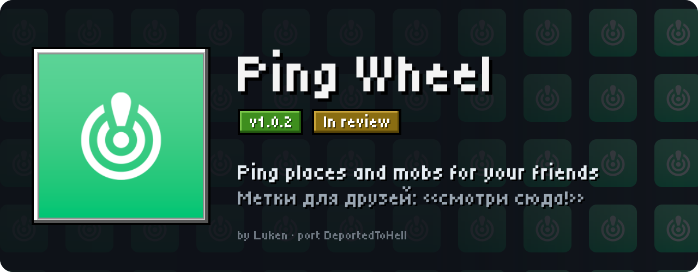
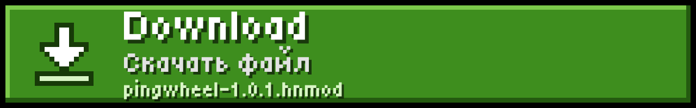
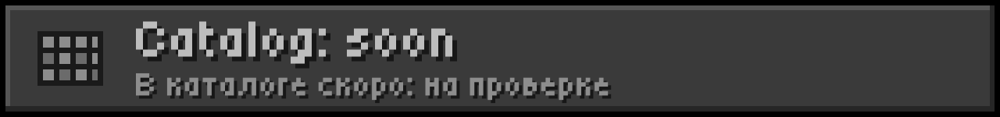
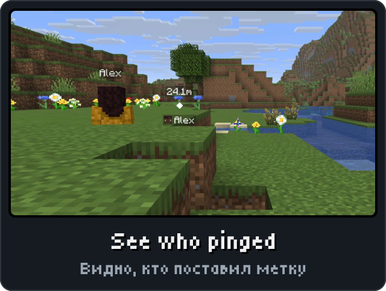
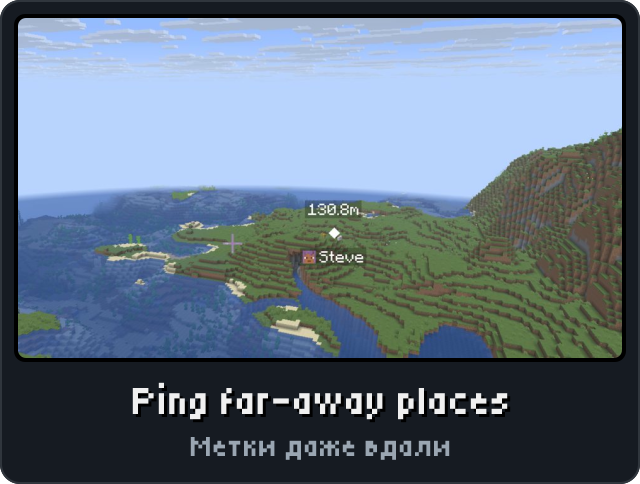
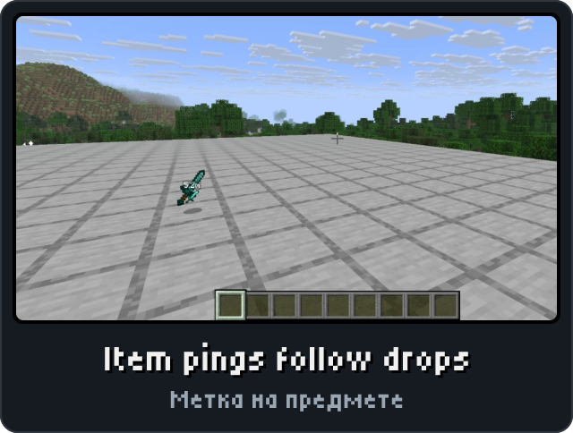
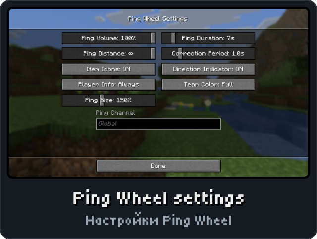

<p align="center"><picture><source media="(max-width: 700px)" srcset="../.github/releases/pingwheel/hero-phone.svg"></picture></p>

<p align="center"><a href="https://github.com/DeportedToHell/MCRE-Mods/releases/download/pingwheel-1.0.1/pingwheel-1.0.1.hnmod"><picture><source media="(max-width: 700px)" srcset="../.github/releases/pingwheel/download-phone.svg"></picture></a><br>
<a href="https://playhorizon.dev/mods"><picture><source media="(max-width: 700px)" srcset="../.github/releases/pingwheel/catalog-phone.svg"></picture></a><br>
<a href="https://github.com/DeportedToHell/MCRE-Mods/releases/tag/pingwheel-1.0.1"><picture><source media="(max-width: 700px)" srcset="../.github/releases/pingwheel/github-phone.svg"></picture></a></p>

<p align="center"></p>

<p align="center">




</p>

<p align="center"></p>

<p align="center"><picture><source media="(max-width: 700px)" srcset="../.github/releases/common/steps-phone.svg"> Build" width="640"></picture></p>

<details>
<summary><b>All features in detail · Все возможности подробно</b></summary>

A port of [Ping Wheel](https://github.com/LukenSkyne/Minecraft-Ping-Wheel) by Luken (contributor RXJpaw) to
[Horizon](https://github.com/horizon-rust/horizon), the Rust rewrite of Minecraft: Java Edition 26.3, as a native
mod (`.hnmod`). Mark locations for your friends, like the pings of modern co-op games. Ported from branch 26.3
(v1.12.2).

### Features

- **Ping Location** key (Mouse 5 "Forward" by default; Options > Controls or Options > Mods > Ping Wheel): pings
  the block or entity under the crosshair, up to 1024 blocks away. While crouching the ray stops at every block's
  outline and on water and lava; standing, it goes through glass, panes, bars and grates as the original's
  `VISUAL` clip does. Bound to the same key as Pick Block, it pings only where Pick Block has nothing to pick.
- **Markers on the HUD**: the distance on a dark label, the white diamond (or the pinged item's own icon), bigger
  when close; off the screen or behind you the marker sits at the screen's edge with an arrow pointing at it.
  Pings on entities follow them. Pings expire after Ping Duration.
- **Corrections and removal**: a second ping within the Correction Period moves your last ping; pinging next to an
  existing ping (within 10 GUI pixels of the crosshair) removes it.
- **Player info**: hold the player list key (Tab) to see who pinged (name and head), or Always, or Compact (the
  head beside the distance), with their team's colour (Team Color: Full, Ping Only, Labels Only, Disabled).
- **The ping sound** from the ping's direction (the original's `ping.ogg`, master volume), with its subtitle.
- **Channels**: `/pingwheel channel <name>` or the settings' Ping Channel field; only players on the same channel
  see your pings. Kept per server, as in Java.
- **Settings screen** as in Java ("Ping Wheel Settings"): the Open Settings key (unbound by default),
  `/pingwheel config`, Options > Mods > Ping Wheel > Configure..., or Configure in [Mod Menu](../modmenu).
- **`/pingwheel`**: `help`, `config`, `channel`, `channel <channel_name>` (`""` for the default channel).
- **The server side in the same file**: single player, a LAN host and a dedicated Horizon server relay pings
  between players with Ping Wheel's rules: channels, the default channel's mode (`auto`: players without a team,
  or in the same team; `global`; `team_only`; `disabled`), a rate limit (5 pings, one back per second),
  player tracking. `/pingwheel:server default_channel|player_tracking|regen_time|rate_limit` for operators (level
  2) and on the console, kept in `config/pingwheel.server.json`.
- **Works with the Java mod**: the same plugin channels (`ping-wheel-c2s:ping-location`,
  `ping-wheel-c2s:update-channel`, `ping-wheel-s2c:ping-location`) on the same bytes, so a Horizon client can ping
  on a Fabric/Forge/NeoForge server running Ping Wheel, and Java clients with Ping Wheel can ping on a Horizon
  server. Tested with two Horizon clients on a Fabric 26.3 server (Fabric API 0.161.0, Ping Wheel 1.12.2): pings
  both ways, channels, team-only, the rate limit and `/pingwheel:server`.
- Kept as Ping Wheel keeps them: `config/pingwheel.json` and `config/pingwheel.server.json` (Gson's layout).
- English and Russian (the Russian is the port's own: the original has none). Mod Menu shows Ping Wheel's icon,
  authors and links.

Differences from the original, where Horizon has no counterpart:

- Voice chat groups and FTB Teams don't exist in Horizon: the team context is the vanilla scoreboard team.
- Distant Horizons' terrain isn't pinged past the loaded chunks (that mod doesn't exist in Horizon).
- The sound is placed once, where the ping is heard from; the original moves it with you for its second of play.
- The markers are drawn with the HUD, under the chat and the player list (the original draws them after them).
- The distance's number format follows the game's language (`1,234.5m`; `1 234,5 м`), not the computer's locale.
- The settings screen opened in a world doesn't pause single player (Horizon's mod screens don't).
- The server's "make sure your version matches" messages name Ping Wheel 1.12.2, the version this port speaks.

</details>

<details>
<summary><b>Install by hand and source code · Установка вручную и исходный код</b></summary>

### Install

From the launcher: Mods, find **Ping Wheel**, Install, then Native build > Build.

By hand: put `pingwheel-<version>.hnmod` in `<game folder>/horizon-native-mods/`, add the line
`mod.pingwheel:true` to `horizon-mods.txt`, then Native build > Build in the launcher.

Native mods are compiled into the game and are not sandboxed: build only code you trust.

### Source layout

```
horizon-native.json          bundle manifest (id, version, pinned Horizon and horizon-mixins revisions)
mixins/pingwheel/
  horizon-mixin.toml         modules and injections
  core/                      crate pingwheel_core: the packets on Java's byte layout, Java's String.hashCode,
                             the server's relay and rate limiter, the config files in Gson's layout, with
                             unit tests (cargo test in a copy of core/)
  glue.rs                    the game side: config, keys, packets, pings, sound, /pingwheel, the server half,
                             /pingwheel:server, Options > Mods and Mod Menu
  hud.rs                     the markers, the direction indicator, the camera's projection
  ray.rs                     the ping's ray through blocks and entities
  screen.rs                  the settings screen
  lang.rs                    the texts (tools/lang.mjs makes it)
  lang_inject.rs             spliced into the game's language: the texts for chat, subtitles and answers
  sound.rs                   spliced beside the game's sound cache: the ping sound from data/ping.ogg
  h_*.rs                     one small helper per injection
  data/                      ping.ogg, icon.png (the original's), arrow32.rgba (tools/arrow.mjs)
  LICENSE, NOTICE
tools/                       package.mjs, lang.mjs, arrow.mjs, png.mjs, assets/ (the original's arrow.png,
                             ping.png, en_us.json, sounds.json, and the port's ru_ru.json)
```

The `.hnmod` file is a zip of `horizon-native.json` and `mixins/`.

Built for Horizon `fdc87aecdbd116bf1e08adcd062fcbaea8c2e2ca` (Nightly 2026-11-08) and horizon-mixins
`5a64af938ec86b00d53d16a408aabc0038fb3e57`. It uses the mod-image atlas rows 976..1008 (the arrow).

</details>

<p align="center"><a href="https://github.com/DeportedToHell/MCRE-Mods/tree/main/pingwheel/mixins/pingwheel"><picture><source media="(max-width: 700px)" srcset="../.github/releases/common/code-phone.svg"></picture></a> <a href="https://github.com/DeportedToHell/MCRE-Mods/issues/new?template=bug-ping-wheel.yml"><picture><source media="(max-width: 700px)" srcset="../.github/releases/common/bug-phone.svg"></picture></a></p>

## Licence and credits

MIT, as the original ([LICENSE](LICENSE), [NOTICE](NOTICE)).

- Ping Wheel: by Luken (LukenSkyne), contributor RXJpaw, https://github.com/LukenSkyne/Minecraft-Ping-Wheel
- The sound, the arrow texture, the icon and the English texts are Ping Wheel's own.
- Ported by DeportedToHell.

This port rewrites Ping Wheel's client and server in Rust for Horizon's native mod API. Not affiliated with Luken,
Mojang or Microsoft.

---

**По-русски.** Порт мода Ping Wheel для Horizon: клавиша «Поставить метку» (по умолчанию боковая кнопка мыши 5
«Вперёд») ставит метку там, куда смотрит прицел, — её видят все игроки на том же канале: расстояние, значок
(или предмет), стрелка у края экрана, звук с нужной стороны. Работает в одиночной игре, по LAN и на сервере
Horizon, совместим с Java-версией мода. Настройки: «Настройки...» в Mod Menu или Настройки > Моды > Ping Wheel,
команда `/pingwheel config`. Каналы: `/pingwheel channel <имя>`. Для операторов сервера —
`/pingwheel:server`.
