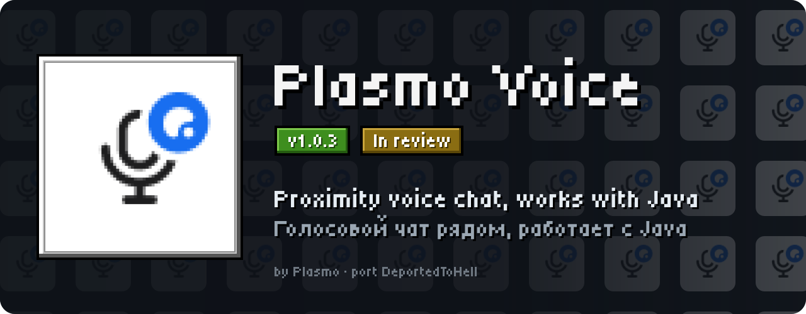
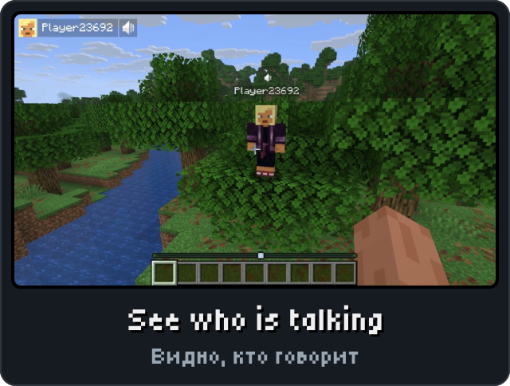
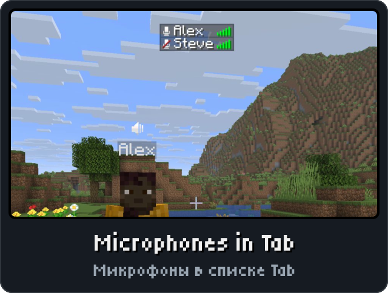
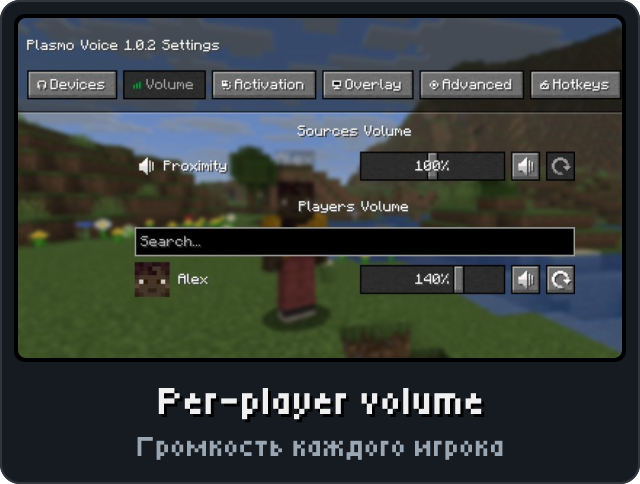
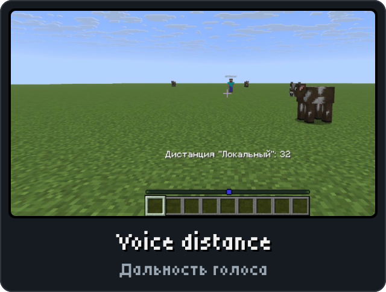

<picture><source media="(max-width: 700px)" srcset="../.github/releases/plasmovoice/hero-phone.svg"></picture>

<a href="https://github.com/DeportedToHell/MCRE-Mods/releases/download/plasmovoice-1.0.2/plasmovoice-1.0.2.hnmod"><picture><source media="(max-width: 700px)" srcset="../.github/releases/plasmovoice/download-phone.svg"></picture></a> 
<a href="https://playhorizon.dev/mods"><picture><source media="(max-width: 700px)" srcset="../.github/releases/plasmovoice/catalog-phone.svg"></picture></a> 
<a href="https://github.com/DeportedToHell/MCRE-Mods/releases/tag/plasmovoice-1.0.2"><picture><source media="(max-width: 700px)" srcset="../.github/releases/plasmovoice/github-phone.svg"></picture></a>

<picture><source media="(max-width: 700px)" srcset="../.github/releases/common/steps-phone.svg"> Build" width="640"></picture>

<b>All features in detail · Все возможности подробно</b>

A port of [Plasmo Voice](https://github.com/plasmoapp/plasmo-voice) by Plasmo (its version 2.2.0) to
[Horizon](https://github.com/horizon-rust/horizon), the Rust rewrite of Minecraft: Java Edition 26.3, as a native mod
(`.hnmod`). Proximity voice chat: you hear the players near you, from where they stand, and they hear you.

### Features

- **Plasmo Voice's protocol** (`plasmo:voice/v2`, UDP, Opus, AES): a Horizon player talks with Java players on any
  server running Plasmo Voice (Paper, Fabric, NeoForge…), and on Horizon worlds.
- **Client and server in one mod**, as the original: the same `.hnmod` is the voice chat for players and the voice
  server on a **dedicated Horizon server** (Horizon and Java players with Plasmo Voice join it), and in a world you
  host (single player opened to LAN), so friends with the mod talk with you without installing anything else.
- **The server as Plasmo Voice's:** its `config.toml`, mutes and texts, the commands `/vlist`, `/vmute`, `/vunmute`,
  `/vmutelist`, `/vreload` and `/vrc` with their permission nodes (see *Server* below).
- **Push to talk** (Left Alt) or **voice activation** with its threshold, per activation, as in the original; **Mute
  microphone** (M), **Disable voice chat**, the activation and distance keys, the **Action** button + wheel for a
  player's volume, **Toggle Sound Occlusion**.
- **The original's sound:** **noise suppression** with RNNoise (the same nnnoiseless build and model Plasmo Voice
  runs, built into the mod), **stereo capture**, **sound occlusion** (blocks between you and a player quieten them,
  smoothed as in the original), **directional sources** with their angle, stereo sources played in stereo or made
  mono, the **source types overlap** rule, **camera sound listener** (third person hears from the camera), the
  **jitter buffer delay**, and the **voice distance sphere** when the distance changes (and on joining, if asked).
- **Plasmo Voice's settings screen** on **V**: the Devices, Volume, Activation, Overlay, Advanced and Hotkeys tabs with
  every row of the original — microphone and speakers, the level meter with the threshold marker and **Test
  microphone**, volumes up to 200%, per-player volume and mute, overlay styles and positions, key bindings.
- **On screen as in Plasmo Voice:** the microphone icon while you talk (and its muted / disabled variants), the list
  of who is talking, and the icons above players' heads.
- Settings kept where Plasmo Voice keeps them: `config/plasmovoice/client.toml`.
- Mod Menu's Configure and Options > Mods > Plasmo Voice > Configure... open Plasmo Voice's Mod Menu screen (Cloth
  Config, as in Java). English and Russian (Plasmo Voice's own translations).

Additions of this port: a microphone before the name of players with voice chat in the player list (Tab) — white
while they talk, crossed out in red otherwise — with its option in the Overlay tab; and the list of who is talking
is on by default (Plasmo Voice: off for proximity).

Defaults changed: the **activation threshold is -60 dB** (Plasmo Voice: -30 dB). A threshold already saved in
`client.toml` stays as it is; the slider's reset button sets -60 dB.

Fixed from the original: **voice activation** measures the microphone as it is sent — after the microphone volume
and noise suppression, as the meter and its threshold marker show it (Plasmo Voice measures the raw microphone, so
suppressed noise could still start a talk); the mono and stereo forms of a frame (with stereo capture) go through
**separate filter states** (Plasmo Voice runs both through one RNNoise); the **player search** on the Volume tab also
filters the players of addons' source lines and direct sources (Plasmo Voice lists those whatever is typed). As in
Plasmo Voice, every Config from the server (`/vreload` too) restarts the microphone, the encoders and the speakers
with its sample rate, codec and MTU.

Differences from the original, where Horizon has no counterpart yet: **HRTF** (OpenAL Soft's, which Horizon's mods
don't have) and the Mod Menu screen's **Javax Input Device** (Java Sound; the port opens the microphone one way, with
cpal) are kept in the settings but change nothing, nor do the Debug Logger and Check For Updates switches; the
hidden `al_playback_buffers` sizes OpenAL's buffer ring, which the port's mixer doesn't have (`adaptive_jitter_buffer`
and the compressor and limiter do nothing in Plasmo Voice either); the voice distance sphere is drawn as a mesh of
lines, not filled; panning is equal-power stereo, not OpenAL Soft's; noise suppression at a server sample rate
other than 48 kHz resamples to 48 kHz for RNNoise (Plasmo Voice feeds the frames as they are, and at 8 or 16 kHz
sends nothing); the About tab and addons are not ported; head icons are drawn over the world, not lit or cut by
blocks; single player isn't paused while the settings are open. On the server: the texts are the bundled English
and Russian (and any file put in `languages/`), not downloaded from Crowdin; `[voice.reuse_port]` is kept in the
file but one socket serves; there is no proxy (BungeeCord/Velocity) support, update check, debug logging switch,
vanish integration or `plasmovoice:` command aliases; target selectors in `/vmute` and `/vunmute` are `@a`, `@p`,
`@r` and `@s` without arguments.

<b>Install by hand and source code · Установка вручную и исходный код</b>

### Install

From the launcher: Mods, find **Plasmo Voice**, Install, then Native build > Build.

By hand: put `plasmovoice-<version>.hnmod` in `<game folder>/horizon-native-mods/`, add the line
`mod.plasmovoice:true` to `horizon-mods.txt`, then Native build > Build in the launcher.

Native mods are compiled into the game and are not sandboxed: build only code you trust.

### Server

On a dedicated Horizon server the same `.hnmod` is the voice server: build the server's engine with it (the
launcher's `horizon-launcher native-build <folder with plasmovoice-<version>.hnmod> --server-output <dir> --version
<release> --trust-native-code`, then `horizon-server --dir <server> config set engine.path=<dir>/horizon-engine` and
restart). Nothing else is needed: players with the mod (Horizon, or Java with Plasmo Voice 2.x) get voice chat when
they join. The server opens no sound device, but the mod's crate links the audio library its client half uses, so
on Linux building the engine needs ALSA's development package (`libasound2-dev` / `alsa-lib-devel`) and running it
needs `libasound.so.2` (`libasound2`), which an unmodded `horizon-engine` doesn't.

Voice goes over **UDP**: open the voice port in the firewall. By default it is the Minecraft server's own port
(`server-port`), on UDP.

Files, where the Fabric mod keeps them: `config/plasmovoice/server/` beside `server.properties`
(in single player and LAN worlds, the game's `config/plasmovoice/server/`):

- `config.toml` — Plasmo Voice's server config, written with every setting and its comment the first time and
  read at each start: `server_id`, `default_language` / `forced_language`, `[host]` `ip` (`0.0.0.0`) and
  `port` (0 = the Minecraft server's port; any free port in a LAN world), `[host.public]` (the address sent to
  clients, for a proxy or NAT), `[voice]` sample rate, MTU, keep-alive timeout, `client_mod_required`,
  `client_mod_min_version`, `[voice.proximity]` `distances` and `default_distance`, `[voice.opus]` mode and
  bitrate, `[voice.player_icon]` visibility and y offset, `[voice.weights]`, `[notifications]`.
  `/vreload` reads it again and sends the new settings (distances...) to everyone.
- `voice_mutes.json` — the mutes (kept over restarts; temporary ones end by themselves).
- `languages/en_us.toml`, `languages/ru_ru.toml` — the server's messages, editable; other languages can be added
  as files. Each player gets them in their game's language (English otherwise).

Commands (players and the server console):

| Command | Permission | Default |
|---|---|---|
| `/vlist` — who has voice chat | `pv.list` | everyone |
| `/vmute <player> [duration] [reason]` — duration `30s`, `15m`, `1h`, `7d`, `2w`, `<unix time>u` or `permanent` | `pv.mute` | operators |
| `/vunmute <player>` (also offline players) | `pv.unmute` | operators |
| `/vmutelist` | `pv.mutelist` | operators |
| `/vreload` — reload `config.toml` and the texts | `pv.reload` | operators |
| `/vrc` — reconnect your voice chat | `pv.reconnect` | everyone |

Other permissions: `pv.activation.proximity` (talk, everyone), `pv.allow_freecam` (everyone),
`pv.bypass_mod_requirement` (operators). "Operators" are players of operator level 2 or above; a permissions mod
(a LuckPerms port) can grant or refuse each node instead.

### Source layout

- `mixins/plasmovoice/engine/` — the voice chat itself, a crate of its own: the protocol (`tcp.rs`, `udp.rs`, `wire.rs`),
  encryption and ids (`crypto.rs`, `md5.rs`), the microphone filters (`dsp.rs`) and RNNoise (`rnnoise/`, nnnoiseless
  0.5.2, BSD-3-Clause, its notice in `rnnoise/mod.rs` and `NOTICE`), Opus and the audio devices
  (`audio.rs`), the client (`client.rs`), the server (`server.rs`) with its config (`server_config.rs`), mutes
  (`mutes.rs`), commands (`server_commands.rs`) and texts (`server_lang.rs`, `lang/`). `cargo test` runs its tests.
- `mixins/plasmovoice/glue.rs` — what joins it to the game: packets, keys, positions, the server's hooks and commands.
- `gui.rs`, `hud.rs`, `tab.rs`, `menu.rs`, `cloth.rs`, `config.rs`, `lang.rs`, `icons.rs` — the screens, the HUD, the
  player list, the settings file, the texts and the icons. `tools/lang.mjs` regenerates `lang.rs`.

<a href="https://github.com/DeportedToHell/MCRE-Mods/tree/main/plasmovoice"><picture><source media="(max-width: 700px)" srcset="../.github/releases/common/code-phone.svg"></picture></a> <a href="https://github.com/DeportedToHell/MCRE-Mods/issues/new?template=bug-plasmo-voice.yml"><picture><source media="(max-width: 700px)" srcset="../.github/releases/common/bug-phone.svg"></picture></a>

## Licence

LGPL-3.0, as Plasmo Voice: see `LICENSE` and `NOTICE`. Not affiliated with Plasmo, Mojang or Microsoft.
