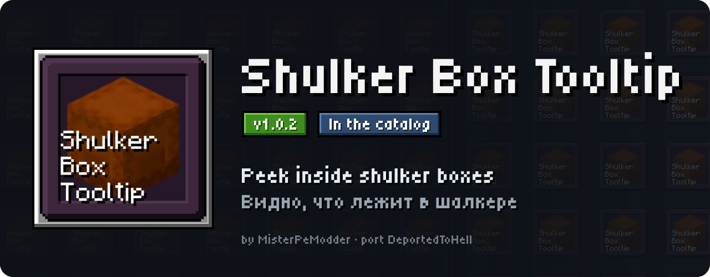
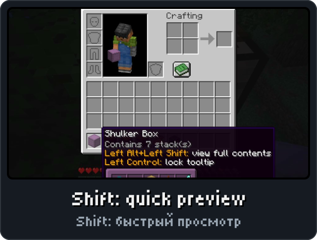
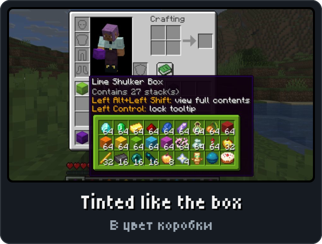
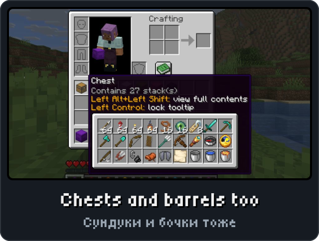
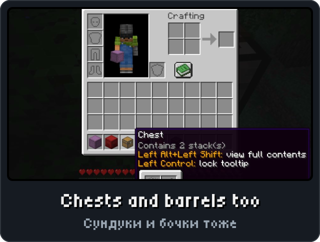

<p align="center"><picture><source media="(max-width: 700px)" srcset="../.github/releases/shulkerboxtooltip/hero-phone.svg"></picture></p>

<p align="center"><a href="https://github.com/DeportedToHell/MCRE-Mods/releases/download/shulkerboxtooltip-1.0.1/shulkerboxtooltip-1.0.1.hnmod"><picture><source media="(max-width: 700px)" srcset="../.github/releases/shulkerboxtooltip/download-phone.svg"></picture></a><br>
<a href="https://playhorizon.dev/mods/shulkerboxtooltip"><picture><source media="(max-width: 700px)" srcset="../.github/releases/shulkerboxtooltip/catalog-phone.svg"></picture></a><br>
<a href="https://github.com/DeportedToHell/MCRE-Mods/releases/tag/shulkerboxtooltip-1.0.1"><picture><source media="(max-width: 700px)" srcset="../.github/releases/shulkerboxtooltip/github-phone.svg"></picture></a></p>

<p align="center"></p>

<p align="center">




</p>

<p align="center"></p>

<p align="center"><picture><source media="(max-width: 700px)" srcset="../.github/releases/common/steps-phone.svg"> Build" width="640"></picture></p>

<details>
<summary><b>All features in detail · Все возможности подробно</b></summary>

A port of [ShulkerBoxTooltip](https://github.com/MisterPeModder/ShulkerBoxTooltip) by MisterPeModder to
[Horizon](https://github.com/horizon-rust/horizon), the Rust rewrite of Minecraft: Java Edition 26.3, as a native
mod (`.hnmod`). "What's in my shulker box?": the contents of a container item right in its tooltip, drawn with
ShulkerBoxTooltip's own window texture, layout and colours.

### Features

- **Key hints** in a container item's tooltip: *Shift: view contents*, *Alt+Shift: view full contents*, and
  *Ctrl: lock tooltip* in container screens. The vanilla "N x item" lines give way to *Contains N stack(s)* or
  *Empty*.
- **Shift: compact preview**: equal items merged into one cell with their total (1.2k, 45k... when "Abbreviate
  large item counts" is on), the largest stacks first or in the container's order.
- **Alt (with Shift): full preview**: every slot where it is in the container, the slots it doesn't have
  shaded.
- **Ctrl: lock the tooltip** while previewing: the tooltip stays where it was, the pointer can move over the
  preview, and the item under it shows its own tooltip.
- Every **shulker box**, tinted with its dye, **chests**, copper chests (all weathering stages, waxed or not),
  **trapped chests**, **barrels**, **furnaces**, blast furnaces, smokers, **droppers**, **dispensers**, **hoppers**,
  **brewing stands**, chiseled bookshelves, decorated pots, the twelve **shelves**, the **lectern** (its book) and
  any other item holding container contents (Generic Container Preview).
- The **ender chest**: in single player (and from a LAN host that has the mod) its real contents; on a server
  without the mod, what it held when you last opened it ("Open your ender chest to enable preview" until
  then), kept per world and per server.
- **Bundles**: the vanilla tooltip by default; with Theme (Bundle) set to Vanilla+ or ShulkerBoxTooltip,
  Shift shows every item of the bundle (no limit), sorted in the compact preview, with the selected item's
  name above it, and the wheel goes through all items in the order the preview shows them.
- Loot tables: "???????", *Has loot table* or the table's id, as Loot Table Info Type says.
- **ShulkerBoxTooltip's config screen** (Configure... on Options > Mods > Shulker Box Tooltip, or Configure in
  [Mod Menu](../modmenu)): the Preview, Tooltip, Colors, Controls and Server tabs, every option with its
  description, Yes/No, choice, key and number buttons and colour fields with their swatch, R (reset to
  default) and U (undo) beside each, italic labels for changes and red for errors, Discard Changes / Save &
  Quit, and the "Changes Not Saved" and "Restart Required" questions. Ctrl+Tab and Ctrl+1..5 switch tabs.
- Every option of the original: preview on/off, swap modes, always on, merging of items with different
  components, compact order, maximum row size, server integration, theme (ShulkerBoxTooltip or Vanilla, the
  bundle preview's look), bundle theme, window position (inside the tooltip, outside, outside top, outside
  bottom), abbreviated counts, generic container preview, key hints, tooltip type (Vanilla, Modded, None),
  loot table info, hiding a shulker box's lore, coloured windows and the colour of each window, the three keys,
  and the server's client integration and ender chest synchronization (none, active, passive).
- Kept as ShulkerBoxTooltip keeps it: `config/shulkerboxtooltip.json5`, with its comments.
- English and Russian, as the game's language (ShulkerBoxTooltip's own translations; the few lines its Russian
  file lacks are translated here). Mod Menu shows ShulkerBoxTooltip's icon and details.

Differences from the original, where Horizon has no counterpart: the tooltip locks in the inventory and
container screens but not in the creative inventory; the per-item overrides a server's data pack can put in
an item's `custom_data` (`shulkerboxtooltip: {...}`) are not read; the ender chest's synchronization talks
Horizon's mod messages, so on a Java server running ShulkerBoxTooltip the cache is used instead.

</details>

<details>
<summary><b>Install by hand and source code · Установка вручную и исходный код</b></summary>

### Install

From the launcher: Mods, find **Shulker Box Tooltip**, Install, then Native build > Build.

By hand: put `shulkerboxtooltip-<version>.hnmod` in `<game folder>/horizon-native-mods/`, add the line
`mod.shulkerboxtooltip:true` to `horizon-mods.txt`, then Native build > Build in the launcher.

Native mods are compiled into the game and are not sandboxed: build only code you trust.

### Source layout

```
horizon-native.json            bundle manifest (id, version, pinned Horizon and horizon-mixins revisions)
mixins/shulkerboxtooltip/
  horizon-mixin.toml           modules and injections
  runtime.rs                   the configuration, its file and option tree, merging and counts: no game types (unit tests)
  glue.rs                      providers, tooltip lines and hints, the preview window, locking, ender chest, bundle wheel
  screen.rs                    ShulkerBoxTooltip's config screen; the icon and Mod Menu's metadata
  flags.rs                     what the client library's tooltip code reads (container lines, lore)
  lang.rs                      ShulkerBoxTooltip's English and Russian texts (made by tools/lang.mjs)
  sprites.rs                   ShulkerBoxTooltip's window texture as pixel runs (made by tools/sprites.mjs)
  h_*.rs                       one small helper per injection
  data/icon.png                ShulkerBoxTooltip's icon, for Mod Menu
  LICENSE, NOTICE
tools/                         check.sh (build into the pinned Horizon), package.mjs, sync.mjs, lang.mjs, sprites.mjs
Cargo.toml                     runs runtime.rs's tests
```

The `.hnmod` file is a zip of `horizon-native.json` and `mixins/`.

Tests: `cargo test` (Rust 1.99.1, edition 2024).

Built for Horizon `fdc87aecdbd116bf1e08adcd062fcbaea8c2e2ca` (Nightly 2026-11-08) and horizon-mixins
`5a64af938ec86b00d53d16a408aabc0038fb3e57`.

</details>

<p align="center"><a href="https://github.com/DeportedToHell/MCRE-Mods/tree/main/shulkerboxtooltip"><picture><source media="(max-width: 700px)" srcset="../.github/releases/common/code-phone.svg"></picture></a> <a href="https://github.com/DeportedToHell/MCRE-Mods/issues/new?template=bug-shulker-box-tooltip.yml"><picture><source media="(max-width: 700px)" srcset="../.github/releases/common/bug-phone.svg"></picture></a></p>

## Licence

MIT License, Copyright (c) 2019 Yanis Guaye (MisterPeModder) and (c) 2026 DeportedToHell for the port
([LICENSE](LICENSE), [NOTICE](NOTICE)). Not affiliated with MisterPeModder, Mojang or Microsoft.

---

**По-русски.** Подсказка шалкерового ящика для Horizon: содержимое шалкеровых ящиков, сундуков, бочек, печей,
воронок и других контейнеров прямо в подсказке предмета. Shift — компактный предпросмотр, Alt+Shift — полный,
Ctrl — закрепить подсказку и навести мышь на предметы внутри. Сундук Края, мешки, цвета окон, клавиши и все
настройки оригинала: Настройки > Моды > Shulker Box Tooltip > «Настройки...» (или кнопка «Настроить» в Mod Menu).
