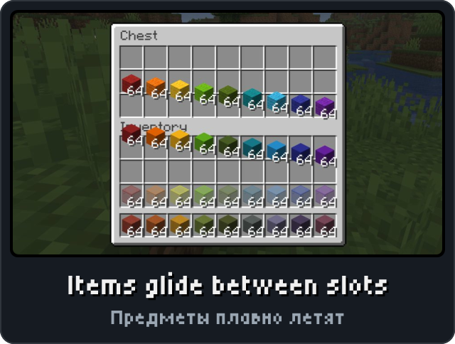
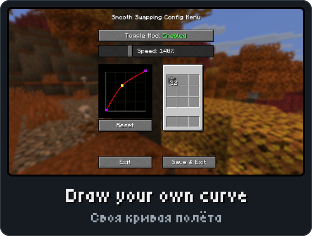
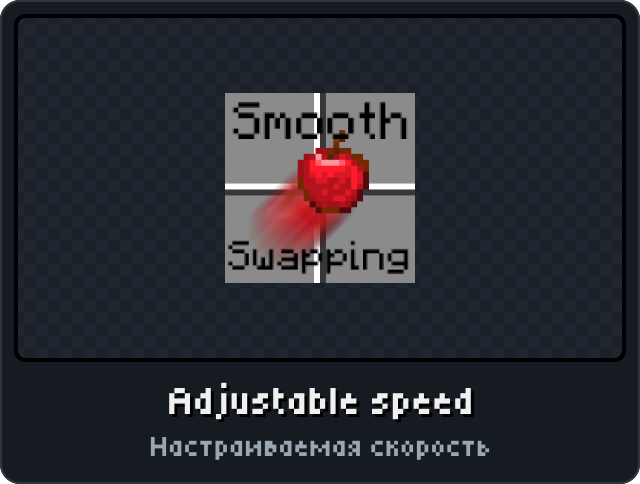
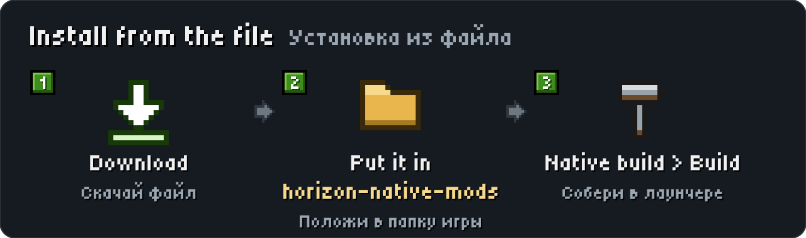

<p align="center"><picture><source media="(max-width: 700px)" srcset="../.github/releases/smoothswapping/hero-phone.svg"></picture></p>

<p align="center"><a href="https://github.com/DeportedToHell/MCRE-Mods/releases/download/smoothswapping-1.1.3/smoothswapping-1.1.3.hnmod"><picture><source media="(max-width: 700px)" srcset="../.github/releases/smoothswapping/download-phone.svg"></picture></a><br>
<a href="https://playhorizon.dev/mods/smoothswapping"><picture><source media="(max-width: 700px)" srcset="../.github/releases/smoothswapping/catalog-phone.svg"></picture></a><br>
<a href="https://github.com/DeportedToHell/MCRE-Mods/releases/tag/smoothswapping-1.1.3"><picture><source media="(max-width: 700px)" srcset="../.github/releases/smoothswapping/github-phone.svg"></picture></a></p>

<p align="center"></p>

<p align="center">



</p>

<p align="center"></p>

<p align="center"><picture><source media="(max-width: 700px)" srcset="../.github/releases/common/steps-phone.svg"> Build" width="640"></picture></p>

<details>
<summary><b>All features in detail · Все возможности подробно</b></summary>

A port of [Smooth Swapping](https://github.com/Schauweg/Smooth-Swapping) by Schauweg and Riflusso (its
current maintainer) to [Horizon](https://github.com/horizon-rust/horizon), the Rust rewrite of Minecraft:
Java Edition 26.3, as a native mod (`.hnmod`). Published with the permission of Schauweg and Riflusso.

### Features

- Items moved in an inventory **fly from slot to slot** instead of jumping: shift-clicks, hotbar keys,
  sorting, crafting results, and stacks taken into the cursor (several at once on a double click).
- The flight follows the original's **animation curve** (a Catmull-Rom spline) at the original's speed.
- **Smooth Swapping's own config screen**, as in Java: Mod Menu's Configure button, or Options > Mods >
  Smooth Swapping > **Configure...**. Toggle Mod, the speed slider (10 to 500%), the curve editor (right
  click on empty space adds a point, drag a point to move it, right click one to delete it; Reset), the
  test inventory whose cobblestone flies along the curve being edited (shift + click), Save & Exit and
  Exit. Exit and Escape put the speed and the curve back, as in the original. Russian texts when the game
  is in Russian.
- The page's buttons under Configure... step through preset speeds and curves, and turn **Fly to the
  cursor** (the port's own) on or off.
- Works on the player's inventory and every container screen drawn on it (not the creative screen, as
  the original).

Drawing only: it works on servers too.

</details>

<details>
<summary><b>Install by hand and source code · Установка вручную и исходный код</b></summary>

### Install

From the launcher: Mods, find **Smooth Swapping**, Install, then Native build > Build.

By hand: put `smoothswapping-<version>.hnmod` in `<game folder>/horizon-native-mods/`, add the line
`mod.smoothswapping:true` to `horizon-mods.txt`, then Native build > Build in the launcher.

Native mods are compiled into the game and are not sandboxed: build only code you trust.

### Source layout

```
horizon-native.json            bundle manifest (id, version, pinned Horizon and horizon-mixins revisions)
mixins/smoothswapping/
  horizon-mixin.toml           modules and injections
  runtime.rs                   which items flew where, the curve, the settings; no game types (unit tests)
  glue.rs                      the inventory screen's slots, frame by frame, and the flights drawn
  screen.rs                    the config screen (`ConfigScreen`), Mod Menu's Configure
  data/icon.png                the mod's icon, for Mod Menu
  *.rs                         one small helper per injection
  LICENSE, NOTICE
Cargo.toml                     runs runtime.rs's tests
tools/                         check.sh (build into Horizon), package.mjs (make the .hnmod)
```

The `.hnmod` file is a zip of `horizon-native.json` and `mixins/`.

Tests: `cargo test` (Rust 1.99.1, edition 2024).

Built for Horizon `9f42064c11efe7ef3e5ed2baad7ddc2a3b36eea0` (Nightly 2026-11-08) and horizon-mixins
`5a64af938ec86b00d53d16a408aabc0038fb3e57`.

</details>

<p align="center"><a href="https://github.com/DeportedToHell/MCRE-Mods/tree/main/smoothswapping/mixins/smoothswapping"><picture><source media="(max-width: 700px)" srcset="../.github/releases/common/code-phone.svg"></picture></a> <a href="https://github.com/DeportedToHell/MCRE-Mods/issues/new?template=bug-smooth-swapping.yml"><picture><source media="(max-width: 700px)" srcset="../.github/releases/common/bug-phone.svg"></picture></a></p>

## Licence and credits

GNU Lesser General Public License, version 3, as the original ([LICENSE](LICENSE), [NOTICE](NOTICE)).

- Smooth Swapping: Copyright (c) 2023 Schauweg; original authors Schauweg and Riflusso (the current
  maintainer), https://github.com/Schauweg/Smooth-Swapping

This port rewrites Smooth Swapping's logic in Rust for Horizon's native mod API; its config screen is the
original's (26.3 branch) drawn with the game's widgets. Its settings live in the mod's Horizon data folder
instead of `smoothswapping.json`. Not affiliated with Schauweg, Riflusso, Mojang or Microsoft.

---

**По-русски.** Порт Smooth Swapping (авторы — Schauweg и Riflusso, нынешний сопровождающий; опубликован
с их разрешения) для Horizon: предметы в инвентаре плавно перелетают из слота в слот. Настройки: кнопка
настроек мода в Mod Menu или Настройки > Моды > Smooth Swapping > «Настройки...» — экран настроек как в
оригинале: включение мода, скорость, редактор кривой и «Образец» для проверки анимации.
