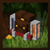
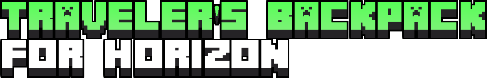

<h1 align="left">
  
  
</h1>

**Version 0.9.9** — nearly all original features implemented. Remaining work is listed below.

**!!! Two files are needed: the content mod `travelersbackpack.hmod` and the native mod `travelersbackpack_native.hnmod`. One alone does not work.**

I'll release an updated mod to the launcher as soon as Horizon rolls out an update that merges `.hnmod` into `.hmod`.


##  This is an independent port of the original project.

> It is not affiliated with, endorsed by, or officially associated with the original author, Tiviacz1337.
>
> Original mod: https://github.com/Tiviacz1337/Travelers-Backpack
>
> Special thanks to [Tiviacz1337](https://github.com/Tiviacz1337) for creating the original mod.


## ✨Features

**Backpacks.** All 44 original designs and five tiers, from leather to netherite. Backpacks can be opened, placed as blocks or worn on the player's back. Other players can see them, and dying while wearing one places it as a block.

**Inventory and upgrades.** The original backpack menu, sorting, quick stacking, tool slots and settings. Upgrades include crafting, furnaces, pickup, magnet, void, feeding, refill, tanks, jukebox and lantern, with configurable filters and toggles.

**Fluids and abilities.** Tanks support water, lava, milk and potions. The hose can suck, spill and drink fluids. Original design-specific abilities are implemented, alongside the sleeping bag, dyeing, cauldron washing and backpack restoration.

**World.** Backpacks and tier upgrades in structure chests, zombies, skeletons and other mobs that sometimes spawn wearing a backpack, and tools shown on the wearer's back.

**Other features.** Dynamic lighting, tool radial menu, advancements, wandering trader trade, creative tab and keybinds. The original's config files (`config/travelersbackpack-{common,server,client}.toml`), Mod Menu info, the `/tb` commands (`access`, `remove`, `clear`, `restore`, `unpack`) with backups made on death, and `/tb_client`. English and Russian translations.


## 🚧Remaining work

1.0.0 - Other mods integration.

Not implemented compared to the original:

- **Other mods' integration.** Accessories / Trinkets (a back slot, `backSlotIntegration`), the deeper part of JEI / EMI / REI (moving a recipe into the crafting upgrade, dragging items into filters; their recipe screens do show the smithing upgrades), Crafting Tweaks, Polymorph, Comforts, grave mods (Pneumono Gravestones, Universal Graves), Tough As Nails, Trash Slot, VinURL and Entity Model Features. Dynamic lighting works without LambDynamicLights.
- **Supporter badge.** The star on the backpacks of the original's supporters needs their list from the internet; the port makes no network requests.

Differences: a Horizon menu holds at most 256 slots, so with the most upgrades and tools the config allows (10 and 8), or filters of more than 10 slots, a tier's storage is cut to what still fits (138 instead of 154 with the defaults).

## 🧩Changelog:

### 0.9.9

- Filter sizes from the config (`filterSlotCount` 1–20, `slotsInRow` 1–5) for the void, pickup, magnet, feeding and refill upgrades: their tabs grow to fit, as the original's.

### 0.9.8

- Tier sizes from the config (`inventorySlotCount`, `upgradeSlotCount`, `toolSlotCount`), kept in each backpack as the original does: a new backpack takes its tier's, a tier upgrade at the smithing table the next tier's.
- A jukebox upgrade in a carried or worn backpack plays a song that follows the player.
- The tool radial menu's icons grow in with it; tool swaps, ability and upgrade sounds are heard by the players around.
- Fluid in the tanks of a backpack item rises smoothly.
- Smithing table tier upgrades are one recipe a design, as the original's: recipe viewers (JEI, REI and others) show each design staying itself.

### 0.9.7

- The creeper design saves its wearer from a blow that kills after armor and effects, as the original (before, from any blow bigger than their health).
- A placed backpack's refill upgrade refills the players within 3 blocks; an item on the cursor counts as carried.
- Sleeping bags laid out from a worn backpack are remembered in the world and taken up after a restart, never dropped.
- Hoppers put no backpack into a shulker box.

### 0.9.6

- Fixed item duplication with placed backpacks in multiplayer: only one player can have a placed backpack open, and taking, breaking, shearing or unpacking it closes that menu first.
- Fixed duplication by dropping or swapping a backpack while its menu is open, and by dying with the menu open.
- The smithing table keeps upgrades and tools in their slots after a tier upgrade, and only accepts backpacks.
- A bottle is one third of a bucket, as in the original; thrown potions no longer return a bottle.
- Ability cooldowns, the cactus design, feeding across dimensions, upgrade keys, pickup with the menu open and furnace progress now behave as in the original; a jukebox upgrade stops playing when taken out or when its backpack is broken or picked up.
- Menus of placed backpacks close at more than 8 blocks or in another dimension; the server tick runs once per dimension.
- Backpacks, shulker boxes and blacklisted items can't be put into any backpack slot.
- Added the config files, Mod Menu info, `/tb` commands, chest loot, mobs with backpacks, tools on the back, the worn backpack's icon in the inventory and right-click insertion into the backpack.


## 📦Installation

Build the content mod with `cargo horizon-mod build` from `content/` and place the resulting `.hmod` in the game's mods folder.

Package the native mod using `tools/package.mjs` and place the resulting `.hnmod` in `<game folder>/horizon-native-mods/`. Add `mod.travelersbackpack_native:true` to `horizon-mods.txt`, then select **Native build → Build** in the launcher.

> Native mods are compiled into the game and are not sandboxed. Only build code you trust.


## 🗂️Source layout

```text
content/                         Content mod, generated from the original checkout
horizon-native.json              Native bundle manifest
mixins/travelersbackpack_native/
  horizon-mixin.toml             Modules and injections
  runtime.rs                     Tiers, designs and names
  glue.rs                        Main mod implementation
  config.rs                      The original's config files
  menu.rs, spider.rs, screen_relayout.rs
                                  Additional modules
  h_*.rs                         Injection helpers
tools/
  content.mjs                    Generates content/ from the original checkout
  check.sh                       Stages the mod on pinned Horizon source and checks/builds the game
  package.mjs                    Packages the .hnmod
```


## ⚖️License

Licensed under **GNU LGPL-3.0**, same as the original project.

**Original author:** [Tiviacz1337](https://github.com/Tiviacz1337)  
**Port author:** [DispatchedToHeaven](https://github.com/DispatchedToHeaven)

See `LICENSE`, `LICENSE.LGPL-3.0`, `LICENSE.GPL-3.0`, and `NOTICE` for details.

This project is an independent port and is not affiliated with or endorsed by Tiviacz1337, Mojang, or Microsoft.
