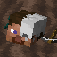

  


## 


> It is not affiliated with, endorsed by, or officially associated with the original author, Patbox.
>
> Original mod: https://github.com/Patbox/UniversalGraves
>
> Special thanks to [Patbox](https://github.com/Patbox) for creating the original mod.


## 


1.0.0. Fully playable.


## 


**Graves.** When you die, your items and some of your experience go into a grave where you fell instead of scattering on the ground. The grave looks for a free spot nearby, stays out of the void and lava, and keeps away from the world border. A message in chat tells you where it is.

**Protection.** For 15 minutes only you can open your grave. After that anyone can. Graves can't be blown up. A grave breaks by itself only if you set a time for it in the config.

**Getting your items back.** Right-click the grave to open it, or sneak and right-click (or hit it) to take everything at once. Items go back to the slots they came from, armor included. With Accessories installed, the grave also takes what you wear in its slots and puts it back there.

**Death compass.** After you respawn you get a compass that points to your grave. Use it to look inside the grave from anywhere.

**/graves.** Lists your graves with where they are, what killed you and how long they are protected. Operators can see everyone's graves (`/graves all`, `/graves player <name>`), break them, take items out, move them or teleport to them.

**Config.** The original's file, `config/universal-graves/config.json`, with the same settings: protection and break times, experience rules, unlock costs, where graves may go, menu icons and every message. `/graves reload` reads it again.

**Server-side.** Like the original, it works on the server alone. Players don't need the mod: the grave is a barrier with floating text and the owner's head, menus are chests. Translated into the original's 24 languages, picked by each player's game language.


## 


1.1.0 - Traveler's Backpack integration. A backpack worn in the Accessories back slot already goes into the grave; one worn without Accessories is still placed on the ground by Traveler's Backpack.

Not implemented compared to the original:

- **Game rules.** `universal_graves:protection_time` and `universal_graves:breaking_time`. Horizon has no way for mods to add game rules yet, so only the config sets these times.
- **Custom grave models.** Only the default model (the owner's head with the text above it). The `models/` folder, the other built-in models (corpses, soul, ender) and `model.alternative` are ignored.
- **Predicates.** `blocking_predicates` and model predicates need the Predicate API, which Horizon doesn't have.
- **Claims.** `block_in_protected_area`: no claim mods exist on Horizon yet.
- **The gravestone block.** The craftable gravestone item and `gravestone_item_base`. An emptied grave can still be left as a gravestone (`create_gravestone_after_emptying`).
- **The safe experience orb** (`alternative_experience_entity`) and invulnerability right after a teleport.
- **Permissions.** Fabric Permissions API nodes: operator levels decide instead.

Not tested in game: Accessories slots (Accessories isn't built for this Nightly yet), LAN with a second player.

Differences: a grave breaks on the first hit for someone who may take from it, since a barrier can't be dug in survival without a client mod. Clicking an item in a grave's menu moves it to your inventory instead of picking it up. Players who don't have the mod's language see the text in English.


## 


### 1.0.0

- First release: graves with items and experience, protection, expiry, menus, `/graves`, death compass, Accessories slots, the original's config.


## 


Find **Universal Graves** in the launcher's Mods section, select Install, then run **Native build → Build**.

For manual installation, place `universalgraves-<version>.hnmod` in `<game folder>/horizon-native-mods/`, add `mod.universalgraves:true` to `horizon-mods.txt`, then run **Native build → Build** in the launcher.

> Native mods are compiled into the game and are not sandboxed. Only build code you trust.


## 


```text
horizon-native.json              Native bundle manifest
mixins/universalgraves/
  horizon-mixin.toml             Modules and injections
  glue.rs                        Deaths, graves, saving, model, menus, commands
  text.rs                        The config's text format and the translations
  defaults.rs                    The config's defaults and the menu heads
  h_*.rs                         Injection helpers
  data/lang/                     The original's translations
  data/icon.png                  Original Universal Graves icon
tools/
  check.sh                       Checks and builds against pinned Horizon source
  package.mjs                    Packages the .hnmod
```

Graves are saved in the world, `data/universal_graves/graves.dat`, in the original's format.


## 


Licensed under **LGPL-3.0**, same as the original project.

**Original author:** [Patbox](https://github.com/Patbox)  
**Port author:** [DispatchedToHeaven](https://github.com/DispatchedToHeaven)

See `LICENSE`, `LICENSE.LGPL-3.0`, `LICENSE.GPL-3.0` and `NOTICE` for details.

This project is an independent port and is not affiliated with or endorsed by Patbox, Mojang or Microsoft.
