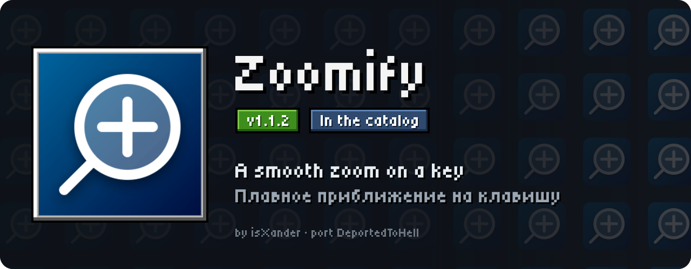
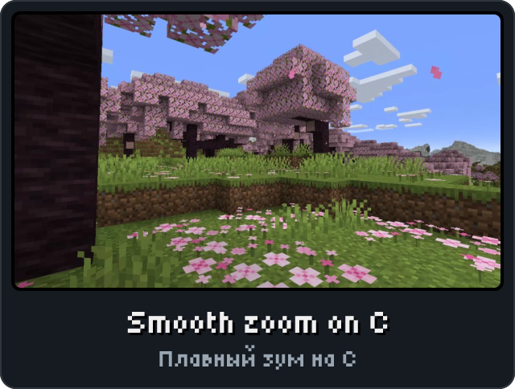
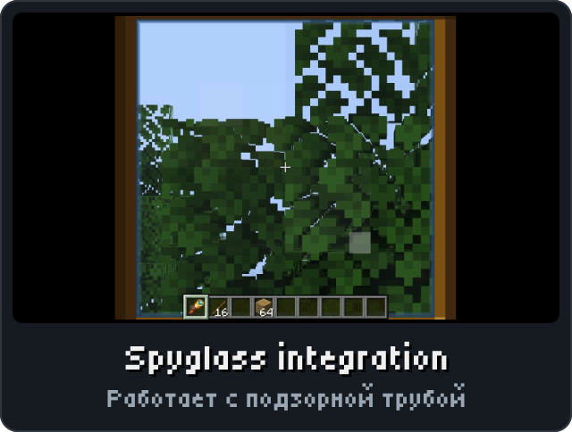
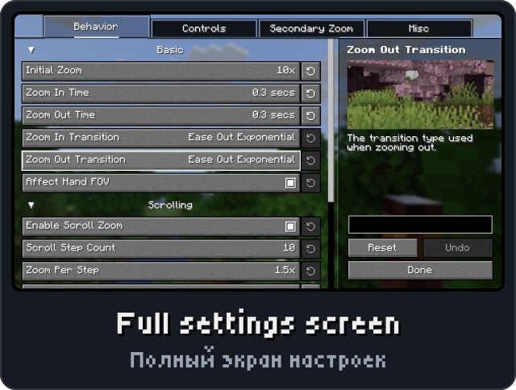

<p align="center"><picture><source media="(max-width: 700px)" srcset="../.github/releases/zoomify/hero-phone.svg"></picture></p>

<p align="center"><a href="https://github.com/DeportedToHell/MCRE-Mods/releases/download/zoomify-1.1.2/zoomify-1.1.2.hnmod"><picture><source media="(max-width: 700px)" srcset="../.github/releases/zoomify/download-phone.svg"></picture></a><br>
<a href="https://playhorizon.dev/mods/zoomify"><picture><source media="(max-width: 700px)" srcset="../.github/releases/zoomify/catalog-phone.svg"></picture></a><br>
<a href="https://github.com/DeportedToHell/MCRE-Mods/releases/tag/zoomify-1.1.2"><picture><source media="(max-width: 700px)" srcset="../.github/releases/zoomify/github-phone.svg"></picture></a></p>

<p align="center"></p>

<p align="center">



</p>

<p align="center"></p>

<p align="center"><picture><source media="(max-width: 700px)" srcset="../.github/releases/common/steps-phone.svg"> Build" width="640"></picture></p>

<details>
<summary><b>All features in detail · Все возможности подробно</b></summary>

A port of [Zoomify](https://github.com/isXander/Zoomify) by isXander to
[Horizon](https://github.com/horizon-rust/horizon), the Rust rewrite of Minecraft: Java Edition 26.3,
as a native mod (`.hnmod`).

### Features

- **Zoom** (C, hold or toggle) with Zoomify's transitions, times and initial zoom; **scroll zoom** with the
  wheel while zooming (or the Scroll Zoom In / Out keys); the **secondary zoom** (F6), slow and cinematic,
  that hides the HUD.
- Relative sensitivity, the cinematic camera while zooming, the hand's field of view, and the
  **spyglass** rules (combine, override, only while holding or carrying it; its overlay and sounds).
- **Zoomify's own config screen**, as in Java (YACL): Mod Menu's Configure button, Options > Mods >
  Zoomify > **Configure...**, or `/zoomify`. Tabs Behavior, Controls, Secondary Zoom and Misc;
  collapsible groups; tick boxes, cycling buttons and sliders with a reset button on each row; the
  description panel with Zoomify's animated demo pictures; search; Undo, Reset / Cancel and
  Done / Save Changes, with changes pending until saved; the presets (Default, OptiFine, OK Zoomer).
  Zoomify's and YACL's own English and Russian texts.
- The old settings buttons stay on the page under Configure... .

</details>

<details>
<summary><b>Install by hand and source code · Установка вручную и исходный код</b></summary>

### Install

From the launcher: Mods, find **Zoomify**, Install, then Native build > Build.

By hand: put `zoomify-<version>.hnmod` in `<game folder>/horizon-native-mods/`, add the line
`mod.zoomify:true` to `horizon-mods.txt`, then Native build > Build in the launcher.

Native mods are compiled into the game and are not sandboxed: build only code you trust.

### Source layout

```
horizon-native.json            bundle manifest (id, version, pinned Horizon and horizon-mixins revisions)
mixins/zoomify/
  horizon-mixin.toml           modules and injections
  runtime.rs                   the zoom's logic and the settings, no game types (unit tests)
  glue.rs                      the keys, the wheel, the field of view, the mouse, the spyglass, the page
  yacl.rs                      the config screen, as YACL 3.9.7 draws Zoomify's
  demo.rs                      its demo pictures and their own zoom (Zoomify's ZoomHelper)
  screen.rs                    the screen over the Options screen, Mod Menu's Configure, the icon
  data/icon.png                Zoomify's icon, for Mod Menu
  data/demo/*.webp             Zoomify's demo pictures
  *.rs                         one small helper per injection
  LICENSE, COPYING, NOTICE
tools/                         check.sh (build into Horizon), package.mjs (make the .hnmod)
```

Tests: `rustc --edition 2024 --test mixins/zoomify/runtime.rs` (Rust 1.99.1).

Built for Horizon `9f42064c11efe7ef3e5ed2baad7ddc2a3b36eea0` (Nightly 2026-11-13) and horizon-mixins
`5a64af938ec86b00d53d16a408aabc0038fb3e57`.

</details>

<p align="center"><a href="https://github.com/DeportedToHell/MCRE-Mods/tree/main/zoomify/mixins/zoomify"><picture><source media="(max-width: 700px)" srcset="../.github/releases/common/code-phone.svg"></picture></a> <a href="https://github.com/DeportedToHell/MCRE-Mods/issues/new?template=bug-zoomify.yml"><picture><source media="(max-width: 700px)" srcset="../.github/releases/common/bug-phone.svg"></picture></a></p>

## Licence and credits

GNU LGPL 3.0 or later, as the original ([LICENSE](LICENSE), [COPYING](COPYING), [NOTICE](NOTICE)).

- Zoomify and YetAnotherConfigLib: Copyright isXander.
- The icon and the demo pictures are Zoomify's own.

Changes from the original: the config screen leaves out Relative View Bobbing (Zoomify itself never
reads it); the cinematic camera's amount is on or off (any amount glides as vanilla's cinematic camera);
Keybind Scrolling takes effect at once, so no restart prompt. Not affiliated with isXander, Mojang or
Microsoft.
